# Phase 2: Information architecture & user flows

Status: **signed off 12 Nov 2026** · Covers product Phase 1 in full; Phase 2 (community) and Phase 3 (competition prep) as outlines only.

---

## 1. Navigation

**Phone (primary):** bottom tab bar with 5 items. The centre item is a larger action button.

| Phase 1 | Home | Recipes | **Brew** (centre) | **Verified** | Profile (incl. Saved) |
|---|---|---|---|---|---|
| Phase 2 | Home | Recipes | **Brew** | **Explore** (Verified becomes a section and filter) | Profile |
| Phase 3 | unchanged; competitions live under Recipes → Competitions | | | | |

A **notices bell** sits in the top bar on Home (badge with unread count).

**Tablet/desktop:** the same five destinations in a top bar (≥ 768 px) or a left rail (≥ 1024 px).

**Logged-out visitors** see a slim top bar: logo, "Verified recipes", "Log in", "Sign up". No tab bar.

**Hidden during brewing:** the guided timer is full screen with no tab bar.

---

## 2. Sitemap

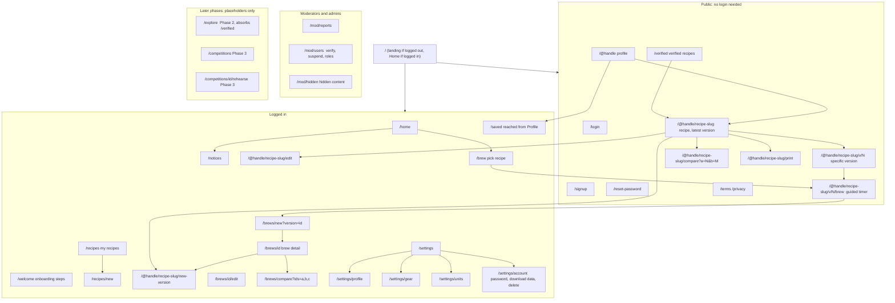

### URL rules
- **One URL per recipe for everyone:** `/@handle/recipe-slug`. The owner sees edit controls on the same page.
- **Private, hidden or deleted recipes return the same "not available" page as a recipe that doesn't exist.**
- **Slugs are fixed at creation.** Renaming keeps the slug. Changing a handle keeps a redirect from the old handle for 90 days.
- `/@handle/recipe-slug` always shows the **latest version**; older versions are at `/v/N`.
- `/verified` is public so share links and the landing page can point to it.

---

## 3. Who can do what

| Action | Logged-out visitor | Member | Verified | Moderator / admin |
|---|---|---|---|---|
| View public profiles, recipes, all versions, version compare, Verified list | ✅ | ✅ | ✅ | ✅ |
| Print / save recipe as PDF | ✅ | ✅ | ✅ | ✅ |
| **Brew a public recipe with the guided timer** | ✅ (sign-up prompt at the end to save the log) | ✅ | ✅ | ✅ |
| Save, copy with credit, "I brewed this" | → sign up, then the action completes | ✅ | ✅ | ✅ |
| Create recipes, log brews, gear, profile | → sign up | ✅ | ✅ | ✅ |
| Make a recipe public (instant) | — | ✅ (email verified; new accounts max 5/day) | ✅ | ✅ |
| Public recipes appear in the Verified tab | — | — | ✅ (automatically) | ✅ if verified |
| Verified badge on profile and recipe cards | — | — | ✅ | ✅ if verified |
| Report a recipe or profile | → log in | ✅ | ✅ | ✅ |
| Hide / restore content, suspend, grant or remove verified | — | — | — | ✅ |
| Change roles (make moderator) | — | — | — | admin only |

### What visitors see of brews
- **Brew logs are always private in Phase 1.**
- Public recipe pages show **counts only**: "v6 · dialled in over 18 brews · brewed by 4 others".
- Other people's tasting notes on a recipe arrive in Phase 2.

### Sign-up hooks for visitors
1. **"Brew this" works without an account.** At the end, saving the brew log asks them to sign up; the filled log is saved straight after sign-up.
2. **Save / Copy / I brewed this** open a short sign-up sheet; after sign-up the action completes and they land back on the same recipe.
3. **Profile and Verified pages** show a small banner: "Log and version your own recipes. Sign up free."

---

## 4. Screens (Phase 1)

| Screen | Main content | Primary action |
|---|---|---|
| **Landing** (logged out) | One-line pitch, 3 benefits, a few Verified recipe cards | Sign up |
| **Home** | Notices bell · "Finish your profile" card (until done) · Continue: last recipe with **Brew again** · Recent brews (5) · Stats strip | Brew again |
| **Notices** | List: verified, recipe hidden (with reason), copied your recipe, brewed your recipe. Unread highlighted; mark all read | — |
| **Recipes** | My recipes: search mine, filter by method and visibility (private / public / hidden), sort by last brewed. Archived tab | New recipe |
| **Recipe** | Header (name, author with verified badge, method, visibility badge, credit line if copied) · version switcher · key numbers · steps with pour curve · coffee · gear · targets · notes · **My brews** (owner) · counts (everyone) | **Brew this version** |
| **Recipe editor** | Basics, coffee, gear (pre-filled), numbers, steps editor, targets, notes · live calculated values · sticky save bar | Save |
| **Version compare** | Two version pickers; changed fields highlighted | — |
| **Verified** | Cards for public recipes by verified profiles, newest first; filter chips by method | Open recipe |
| **Brew picker** | Recent recipes, search mine, saved recipes | Pick → timer or log only |
| **Guided timer** | Full screen: clock, current step, next step, count-in, sound/vibration toggles, Pause, End brew | Start |
| **Brew log** | Recipe + version (locked), date/time · results · computed ratio and EY vs targets · 8 sliders + live radar · flavour tags · tasted at · notes · "Next time I'll change…" | Save brew |
| **Brew detail** | Everything from the log, radar, results vs targets | Create next version · Brew again · Compare |
| **Brew compare** | 2–3 brews: radar overlay, side-by-side table | — |
| **Profile** | Photo, name, handle, verified badge, experience level, bio, favourite gear, stats, public recipes. **Own profile adds:** Saved section, Edit profile, Settings link | — |
| **Settings** | Profile, Gear, Units & region, Account (password, download my data, delete account), Log out | — |
| **Mod: reports / users / hidden** | Report list with hide or dismiss; user search with verify, suspend; hidden content with restore | — |

---

## 5. Recipe status model

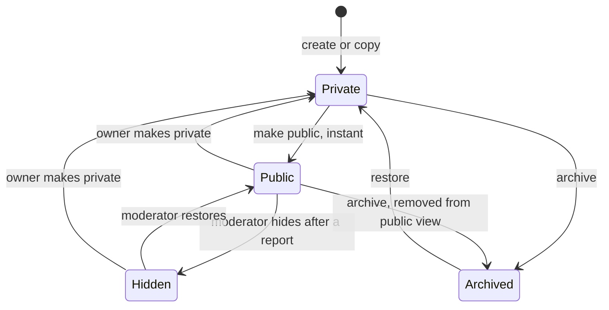

New versions of a public recipe go live instantly. A hidden recipe stays hidden across new versions until a moderator restores it.

---

## 6. Primary flows

### F1. Registration and login

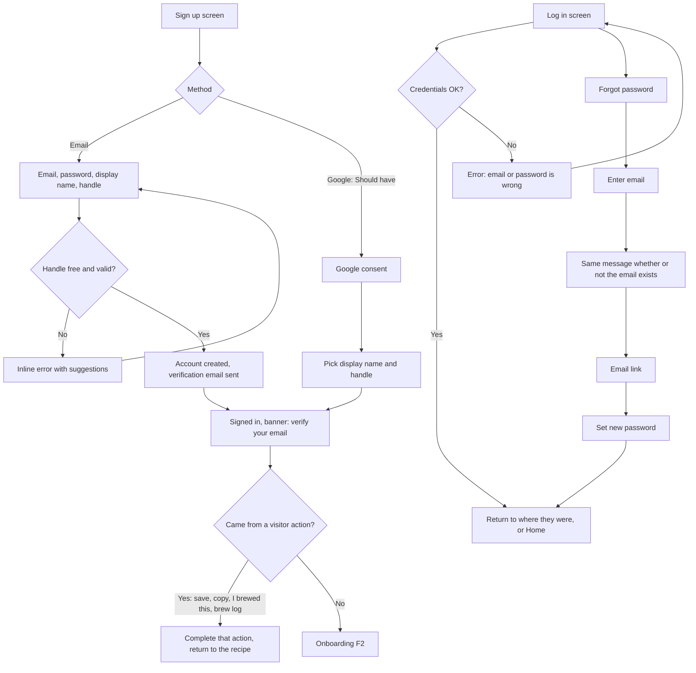

**Edge cases**
- Unverified email can use the app but **can't make recipes public** until verified.
- Handle rules: 3–30 characters, lowercase letters, numbers, underscore; reserved words blocked (`mod`, `admin`, `settings`, `explore`, `verified`, `api`, `notices` …).
- Too many failed logins → short cooldown message.
- Suspended account → login shows "Your account is suspended" with a contact link.

### F2. Onboarding (every step skippable)

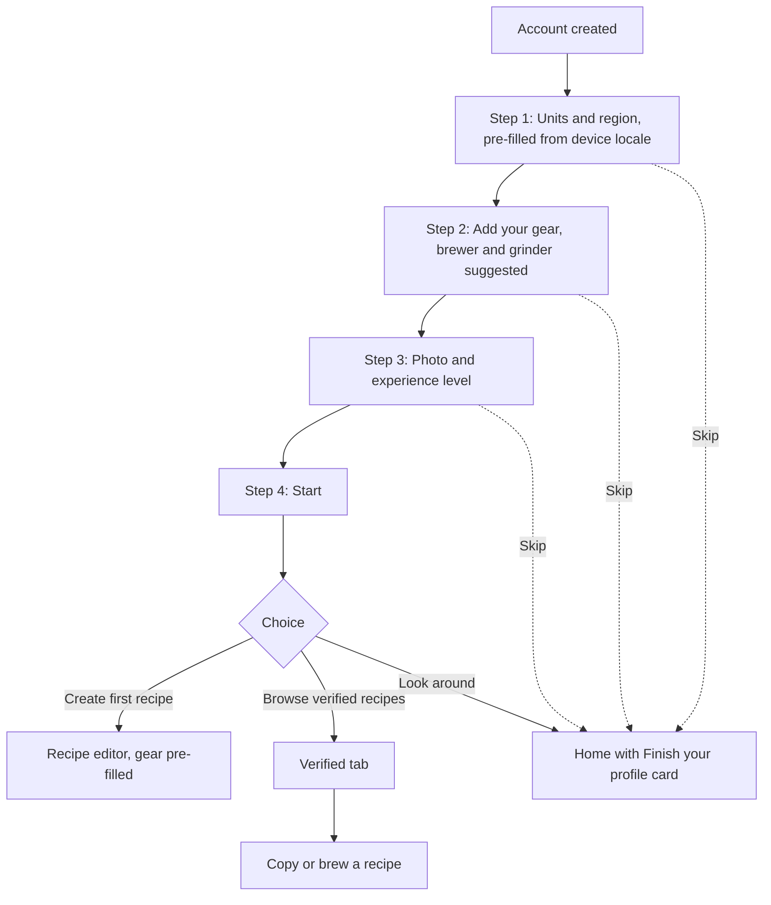

Skipped steps show as a checklist in the "Finish your profile" card on Home until done or dismissed.

### F3. Equipment setup

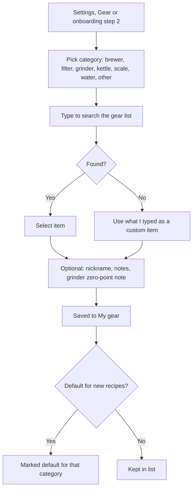

One default per category; several items allowed per category. Deleting a gear item doesn't change existing recipes, which keep the item's name.

### F4. Create a recipe

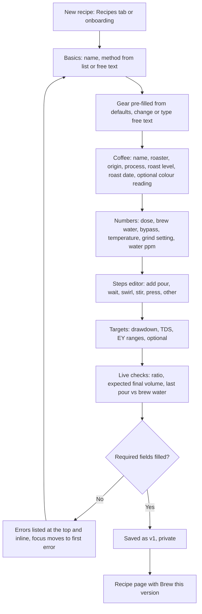

**Required to save:** name, method, dose, brew water. A recipe without steps can be logged against; the timer then shows a simple stopwatch.
**Edge cases:** unsaved changes → confirm dialog; last pour ≠ brew water → warning only; offline → "Creating and editing recipes needs a connection".

### F5. Version a recipe

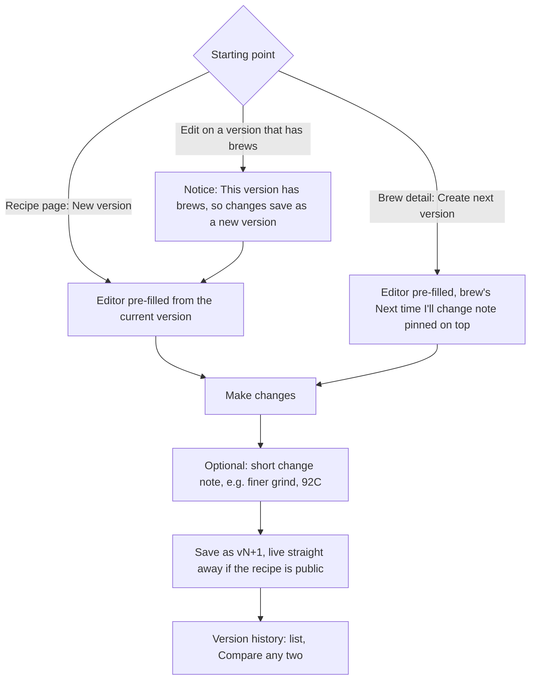

A version with **no brews** can be edited in place. A version **with brews** is locked except for name and notes. The editor shows "3 fields changed" before saving.

### F6. Brew and log (timer or log only)

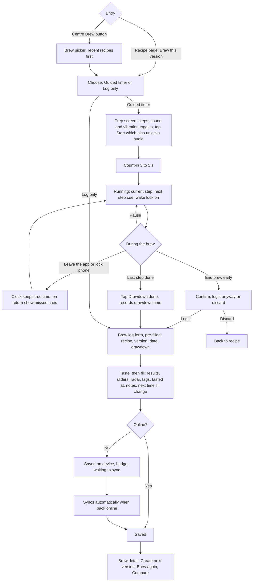

**Edge cases**
- Brewing someone else's public recipe → saved as "I brewed this"; appears in **my** brew history with a credit line; the author gets a notice.
- Logged-out visitor → sign-up sheet after the form; the filled log is kept on the device and saved after sign-up.
- Can be saved with only the overall score filled in.
- Editing a brew later is allowed; the version it points at can't change.
- The draft log is auto-saved on the device while filling it in.

### F7. Make a recipe public or private

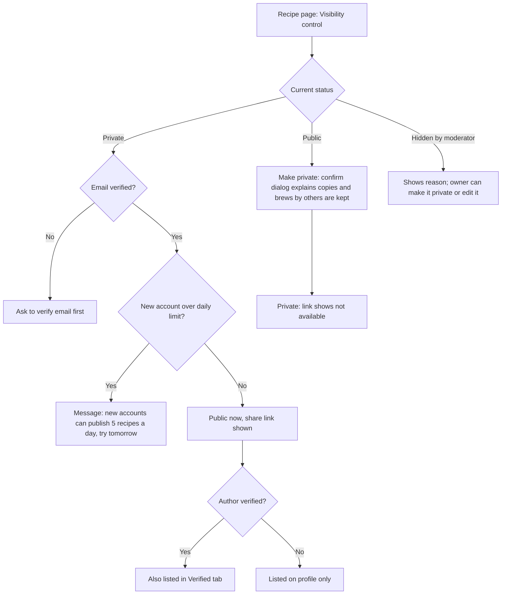

### F8. Visitor opens a shared link

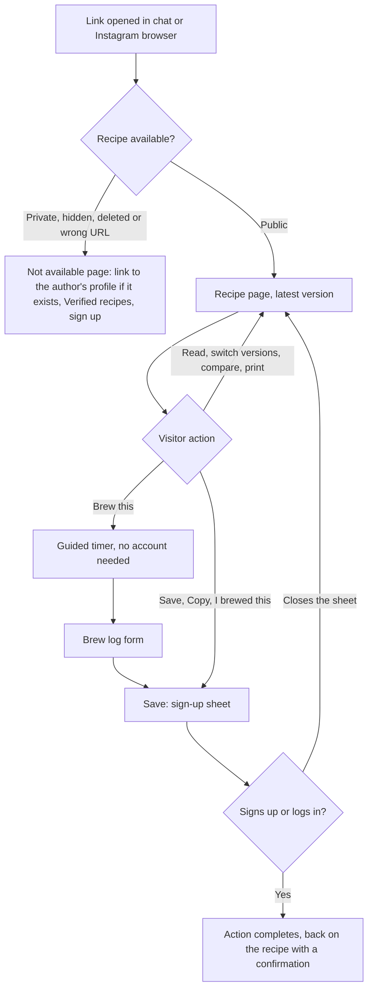

### F9. View a profile and its stats

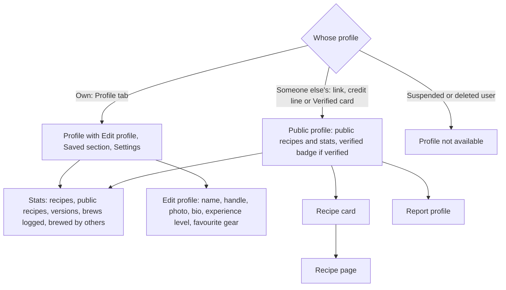

**Stats counting rules:** "brews logged" counts all of the user's brews (number only). "Brewed by others" counts distinct other users who logged "I brewed this" on any of their public recipes. Archived recipes aren't counted on the public profile.

### F10. Moderation (after posting)

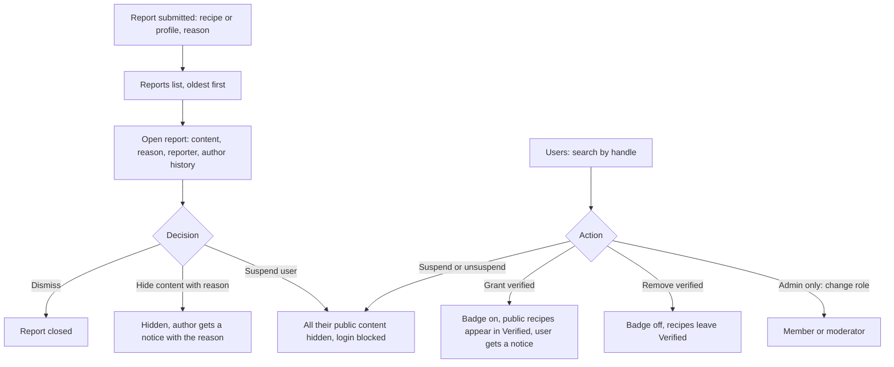

### F11. Account: download data and delete account

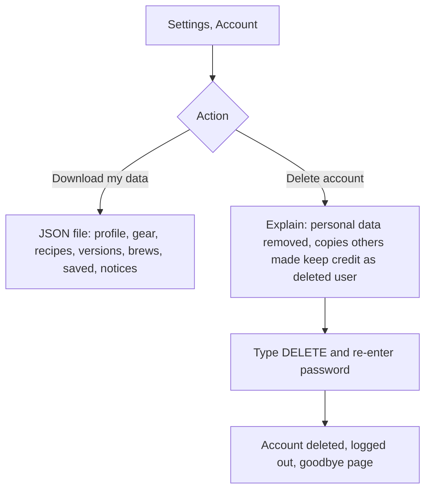

---

## 7. Notifications (Phase 1)

| Notice | Trigger | Channel |
|---|---|---|
| You've been verified | Moderator grants verified | In-app |
| A moderator hid your recipe (reason) | Moderator hides content | In-app |
| @user copied your recipe | Copy with credit | In-app |
| @user brewed your recipe | "I brewed this" saved | In-app (grouped per recipe per day) |
| Email verification, password reset | Account actions | Email (Supabase Auth) |

No push notifications and no other emails. Phase 2 adds follows, upvotes and comments to the same in-app list.

---

## 8. Empty states

| Where | Who | Message and action |
|---|---|---|
| Home | New user | "Your brew bar is empty. Create your first recipe or brew one from Verified." → New recipe / Verified |
| Notices | None | "No notices yet." |
| Recipes | No recipes | "No recipes yet. Every recipe you create is private until you share it." → New recipe |
| Recipes, filtered | No matches | "No recipes match these filters." → Clear filters |
| Recipe page, My brews | No brews | "No brews yet for this version." → Brew this version |
| Version history | Only v1 | "This is the first version. Brew it, then save what you change as v2." |
| Verified | None yet | "Verified recipes from trusted brewers will appear here soon." |
| Verified, filtered | No matches | "No verified recipes for this method yet." → Clear filter |
| Brew picker | No recipes | "You need a recipe to brew. Create one or pick one from Verified." |
| Saved (Profile) | Nothing saved | "Recipes you save from other brewers appear here." → Verified |
| Own profile | No public recipes | "You have no public recipes yet. Make one public from its page." |
| Someone's profile | No public recipes | "@handle hasn't shared any recipes yet." |
| Gear | No gear | "Add your brewer and grinder so new recipes fill in automatically." → Add gear |
| Brew compare | Fewer than 2 brews | "Pick at least two brews to compare." |
| Mod reports | None | "No open reports." |
| Offline, data not cached | Any | "You're offline. Recipes you've opened before and your brew logs still work." |

## 9. Global edge cases

| Case | Behaviour |
|---|---|
| Offline | Banner "Offline". Own cached recipes, timer and brew logging work; other actions show "Needs a connection" without losing input |
| Brew edited on two devices | Server keeps the latest save; the other device shows "This brew was updated elsewhere" and reloads it |
| Session expired | Log in again and return to the same screen; unsent brews stay queued |
| Saved recipe deleted or made private | Saved list shows "No longer available"; remove option |
| Original of a copy deleted or made private | Credit line shows author name without a link |
| Author account deleted | Credit shows "deleted user" |
| Verified status removed | Recipes leave the Verified tab immediately; nothing else changes |
| Very long names and notes | Truncated with full text on tap; limits: name 80 chars, notes 5,000 chars |
| Unit switch | All numbers re-display instantly; stored values never change |

---

## 10. Later phases: outlines only

### Phase 2: community (Verified tab becomes Explore)

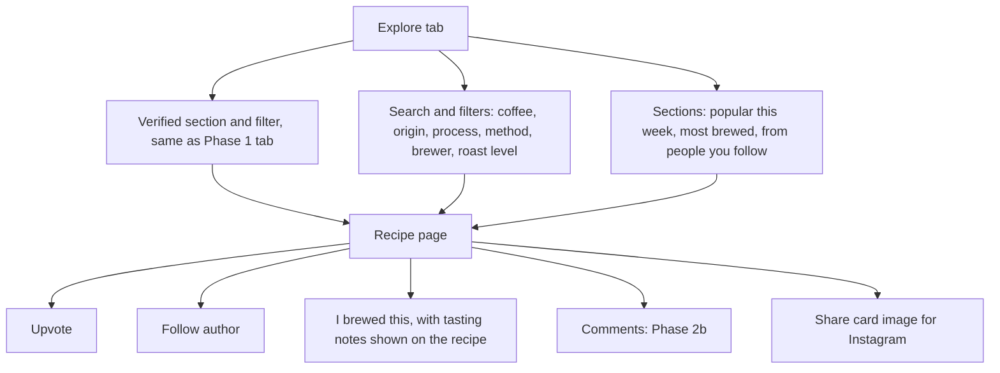

Structure needed now: recipe page has room for an upvote count, a "brewed by others" section and a comments area; profile has room for follower counts; notices list accepts new types.

### Phase 3: competition prep

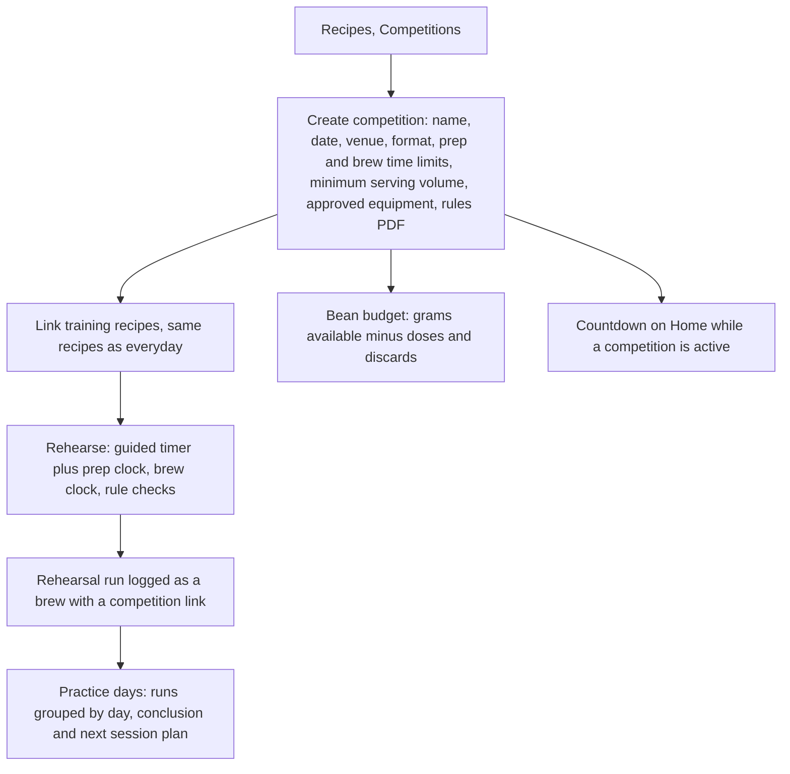

Structure needed now: the timer is a reusable component that accepts extra clocks and rule checks; brews can carry an optional competition link; Home has a slot for an active-competition card.

---

## 11. Decisions in this phase
1. Tabs: Home · Recipes · Brew (centre) · **Verified** · Profile (Saved inside Profile); Verified becomes Explore in Phase 2.
2. Home = "my brew bar" with a notices bell.
3. Sign-up asks only for email, password, name and handle; onboarding steps skippable.
4. One brew flow with two entries; guided timer or log only.
5. URLs `/@handle` and `/@handle/recipe-slug`; visitors can read, compare, print and brew; sign-up prompted on save, copy, I brewed this and saving a brew log.
6. Brew logs private; public pages show counts only.
7. Creating and editing recipes needs a connection; brewing and logging work offline.
8. **Public recipes go live instantly; moderation after posting** (report → hide / suspend).
9. **Verified profiles** (moderators only) get a badge; all their public recipes appear in Verified automatically.
10. Email verification to publish; new accounts (< 7 days) max 5 public recipes per day.
11. Notifications in-app only, plus account emails; no push.
12. Upvote only in Phase 2.
