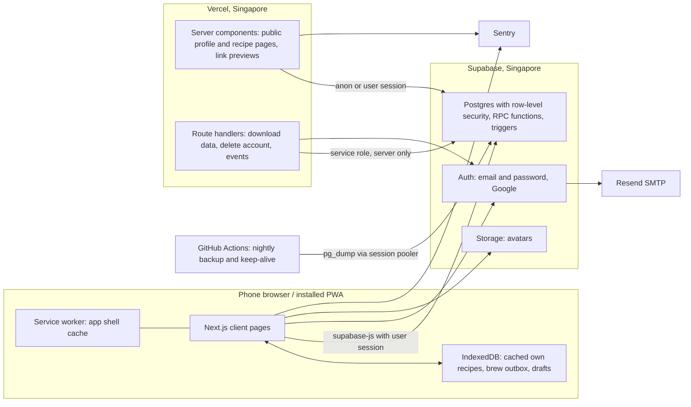
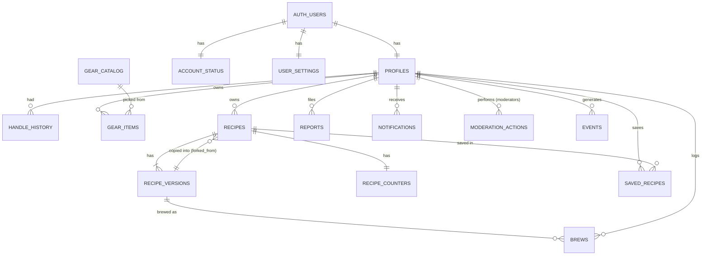
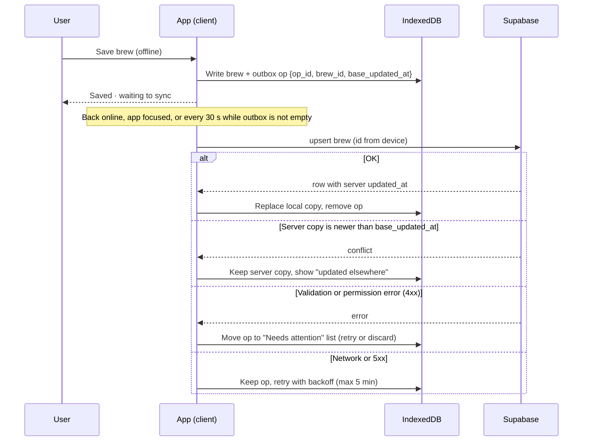

> **Superseded in parts. Read with `phase-4-amendments.md`, `phase-5-roadmap.md` and `decision-log.md`. Where they disagree, the newer doc wins:**
> - Charts: **Recharts v3 (lazy-loaded)**, not hand-built SVG. Data fetching: **TanStack Query v5**.
> - Environments: **no Docker / no local Supabase**. Dev and preview use the **brew-staging** project; production is **brew-production**. Migrations are applied with `supabase db push` to staging, and to production only by the release workflow.
> - Keys: new Supabase API keys. `NEXT_PUBLIC_SUPABASE_PUBLISHABLE_KEY` (`sb_publishable_…`) and `SUPABASE_SECRET_KEY` (`sb_secret_…`) replace the anon and service-role keys.
> - Gear catalogue rows ship in a migration, not seed data. Sign-up is invite-only during the alpha (see roadmap §4).
> - `recipe_counters` rows are created by an `after insert` trigger on `recipes` (migration `…_fix_recipe_counters.sql`); §4's `create_recipe` failed for normal members. See `decision-log.md`.
> - Database connections use the session pooler (direct host is IPv6-only); the Supabase CLI is pinned and hosted commands pass `--remote`/`--yes` or `--db-url`.

# Phase 4: System design

Status: **draft for sign-off** · 13 Nov 2026 · Designs the foundations for all product phases; only product Phase 1 tables are created now. Later phases are listed as planned migrations.

---

## 1. Stack

| Layer | Choice | Why |
|---|---|---|
| Framework | **Next.js (App Router), React, TypeScript (strict)** | Server-rendered public pages for link previews and SEO; app-like client pages for brewing and logging; prototype was React + TS, so its logic carries over |
| Hosting | **Vercel Hobby (free)**, functions in **Singapore (`sin1`)** | Zero-config Next.js hosting; free while the project is non-commercial; region next to the database |
| Backend | **Supabase Free**: Postgres, Auth, Storage, region **Singapore** | Chosen backend; RLS for private/public data; closest region to Malaysia/SEA |
| Supabase client | `@supabase/supabase-js` + `@supabase/ssr` (cookie sessions) | Official way to use Supabase Auth with server-rendered Next.js |
| Styling | **CSS custom properties from the design tokens + CSS Modules** | Tokens stay the single source of truth; plain CSS suits Aaron's skills; no class soup to review |
| Charts | **Hand-built SVG components** (radar, pour curve; trend charts later) | Small and fully accessible. Avoids the prototype's ~840 kB bundle, which was mostly chart and animation libraries |
| Offline | Service worker via **Serwist**, local data in **IndexedDB via Dexie** | Precached app shell; offline brewing and logging with an outbox |
| Validation | **Zod** schemas shared by client and server | One definition of a valid recipe/brew |
| Testing | **Vitest** (unit), **Playwright** (end-to-end, incl. mobile viewport), **axe** (accessibility checks) | Prototype had no tests; calc, steps and sync logic need them most |
| Errors | **Sentry** (free tier) | Catches crashes and failed syncs |
| Email | **Custom SMTP via Resend** (free tier) on Aaron's existing domain | Supabase's built-in mailer is for testing only |

Library versions are pinned in milestone M0, using the latest stable releases at build time.

### Prototype reuse (explicit)
| From prototype | Reuse? | How |
|---|---|---|
| `lib/calc.ts` (ratio, EY, volume checks) | **Yes, port** | Rewritten against the new data model, with unit tests |
| `lib/steps.ts` (step kinds, totals, derived bloom) | **Yes, port** | Same step concept; add `press`; remove stored derived values |
| Rehearsal timer logic (`Timer.tsx`: count-in, cues, wake lock, `performance.now()` clock) | **Yes, port the logic** | New UI; the clock-from-timestamp approach stays |
| Steps editor UX (`StepsEditor`) | **Pattern only** | Rebuilt with new components |
| Sync queue idea (`store.tsx`) | **Pattern only, redesigned** | Server timestamps, per-record conflicts, dead-letter handling (fixes handoff §8 issues) |
| Apps Script backend, shared token, Tailwind config, Recharts, Framer Motion | **No** | Replaced |

---

## 2. Architecture



**Rules:**
- The browser talks to Supabase directly with the user's session; **row-level security is the real security boundary**.
- Multi-step writes (create version, publish, copy, save brew, report, moderation) go through **Postgres RPC functions** so their rules live in one place.
- The **service-role key exists only on the server** (route handlers): account deletion and data export. Never in client code.

---

## 3. Data model

### Entity overview (Phase 1)



### Key modelling decisions
1. **Recipe → versions → brews.** A recipe holds identity (owner, slug, name, method, visibility). Each version holds everything that affects brewing. Brews point at one version.
2. **Versions lock** when the first brew references them (trigger). After that only `notes` and `change_note` can change.
3. **Brews don't copy the recipe.** They keep a small snapshot (recipe name, author handle, version number) so "I brewed this" logs still read correctly if the original is deleted or made private.
4. **Steps are JSON** on the version (`steps jsonb`), validated by Zod, with a `steps_schema` number for future changes. Fields we'll filter on later (method, roast level, process, origin, brewer, grinder) are real columns.
5. **Gear on a version** is stored as a JSON snapshot of names (so shared recipes read correctly), plus `brewer_catalog_id` and `grinder_catalog_id` columns for Phase 2 filtering.
6. **All values stored in metric** (g, °C, seconds). Units are display-only.
7. **Server-set timestamps** (`updated_at` by trigger), never the client clock (fixes a prototype issue).
8. **Roles and suspension live in `account_status`**, which users can read but never write. `is_verified` and `hidden_at` on public tables are guarded by a trigger so only moderators can change them.
9. **Soft delete for recipes** (`deleted_at`), hard delete for accounts (personal data removed; others' copies and brews keep their snapshots).
10. **Counts shown publicly** (brews, brewed by others, copies, saves) live in a trigger-maintained `recipe_counters` table, so brew logs themselves stay private.

---

## 4. Phase 1 schema (SQL)

Run as the first migration in M0/M1. Postgres on Supabase.

```sql
-- =====================================================================
-- 0. Extensions and enums
-- =====================================================================
create extension if not exists citext;

create type public.app_role          as enum ('member', 'moderator', 'admin');
create type public.experience_level  as enum ('beginner', 'enthusiast', 'advanced', 'professional', 'competitor');
create type public.gear_category     as enum ('brewer', 'filter', 'grinder', 'kettle', 'scale', 'water', 'other');
create type public.recipe_visibility as enum ('private', 'public');
create type public.brew_method       as enum ('pour_over', 'immersion', 'hybrid', 'aeropress', 'french_press', 'siphon', 'cold_brew', 'other');
create type public.roast_level       as enum ('light', 'medium_light', 'medium', 'medium_dark', 'dark');
create type public.bypass_timing     as enum ('none', 'before', 'after');
create type public.brew_source       as enum ('timer', 'manual');
create type public.tasted_temp       as enum ('hot', 'warm', 'cool');
create type public.report_target     as enum ('recipe', 'profile');
create type public.report_reason     as enum ('spam', 'offensive', 'impersonation', 'copied_without_credit', 'other');
create type public.report_status     as enum ('open', 'dismissed', 'actioned');
create type public.notification_type as enum ('verified', 'recipe_hidden', 'recipe_restored', 'recipe_copied', 'recipe_brewed');
create type public.mod_action        as enum ('hide', 'restore', 'suspend', 'unsuspend', 'verify', 'unverify', 'role_change', 'dismiss_report');

-- =====================================================================
-- 1. Generic helpers
-- =====================================================================
create or replace function public.set_updated_at()
returns trigger language plpgsql as $$
begin
  new.updated_at := now();
  return new;
end $$;

-- =====================================================================
-- 2. People
-- =====================================================================
create table public.profiles (
  id                uuid primary key references auth.users(id) on delete cascade,
  handle            citext not null unique
                    check (handle ~ '^[a-z0-9_]{3,30}$'),
  handle_confirmed  boolean not null default true,   -- false for Google sign-ups until they pick one
  display_name      text not null check (char_length(display_name) between 1 and 60),
  bio               text check (char_length(bio) <= 300),
  avatar_path       text,
  experience_level  public.experience_level,
  favourite_gear    jsonb not null default '[]'::jsonb
                    check (jsonb_typeof(favourite_gear) = 'array'),  -- [{ "category": "grinder", "name": "Comandante C40" }]
  is_verified       boolean not null default false,  -- moderators only (guarded)
  verified_at       timestamptz,
  hidden_at         timestamptz,                     -- moderators only (guarded)
  hidden_reason     text,
  created_at        timestamptz not null default now(),
  updated_at        timestamptz not null default now()
);
create trigger profiles_updated_at before update on public.profiles
  for each row execute function public.set_updated_at();
create index profiles_verified_idx on public.profiles (id) where is_verified;

create table public.reserved_handles (handle citext primary key);
insert into public.reserved_handles (handle) values
  ('admin'), ('mod'), ('moderator'), ('api'), ('settings'), ('explore'), ('verified'),
  ('notices'), ('recipes'), ('brew'), ('brews'), ('saved'), ('home'), ('welcome'),
  ('login'), ('signup'), ('reset-password'), ('terms'), ('privacy'), ('help'),
  ('competitions'), ('about'), ('support'), ('app'), ('www');

create table public.handle_history (
  old_handle  citext primary key,
  user_id     uuid not null references public.profiles(id) on delete cascade,
  changed_at  timestamptz not null default now()
);

create table public.account_status (
  user_id          uuid primary key references auth.users(id) on delete cascade,
  role             public.app_role not null default 'member',
  suspended_at     timestamptz,
  suspended_reason text,
  updated_at       timestamptz not null default now()
);
create trigger account_status_updated_at before update on public.account_status
  for each row execute function public.set_updated_at();

create table public.user_settings (
  user_id      uuid primary key references auth.users(id) on delete cascade,
  temp_unit    text not null default 'c'  check (temp_unit in ('c', 'f')),
  weight_unit  text not null default 'g'  check (weight_unit in ('g', 'oz')),
  date_format  text not null default 'dmy' check (date_format in ('dmy', 'mdy', 'ymd')),
  time_format  text not null default '24h' check (time_format in ('12h', '24h')),
  time_zone    text not null default 'UTC',
  onboarding   jsonb not null default '{}'::jsonb,   -- which onboarding steps are done/dismissed
  updated_at   timestamptz not null default now()
);
create trigger user_settings_updated_at before update on public.user_settings
  for each row execute function public.set_updated_at();

-- Role/state helpers used by policies (security definer so policies can read account_status)
create or replace function public.is_moderator()
returns boolean language sql stable security definer set search_path = public as $$
  select exists (
    select 1 from public.account_status
    where user_id = auth.uid() and role in ('moderator', 'admin') and suspended_at is null
  );
$$;

create or replace function public.is_admin()
returns boolean language sql stable security definer set search_path = public as $$
  select exists (
    select 1 from public.account_status
    where user_id = auth.uid() and role = 'admin' and suspended_at is null
  );
$$;

create or replace function public.is_suspended(uid uuid)
returns boolean language sql stable security definer set search_path = public as $$
  select coalesce((select suspended_at is not null from public.account_status where user_id = uid), false);
$$;

create or replace function public.email_is_verified(uid uuid)
returns boolean language sql stable security definer set search_path = public, auth as $$
  select coalesce((select email_confirmed_at is not null from auth.users where id = uid), false);
$$;

-- Create profile, status and settings when an auth user is created.
-- Sign-up passes handle and display_name in user metadata. Google sign-ups get a temporary handle.
create or replace function public.handle_new_user()
returns trigger language plpgsql security definer set search_path = public as $$
declare
  wanted   citext := lower(coalesce(new.raw_user_meta_data->>'handle', ''));
  chosen   citext;
  confirmed boolean := true;
begin
  if wanted ~ '^[a-z0-9_]{3,30}$'
     and not exists (select 1 from public.reserved_handles where handle = wanted)
     and not exists (select 1 from public.profiles where handle = wanted)
     and not exists (select 1 from public.handle_history where old_handle = wanted) then
    chosen := wanted;
  else
    chosen := 'brewer_' || substr(replace(new.id::text, '-', ''), 1, 10);
    confirmed := false;
  end if;

  insert into public.profiles (id, handle, handle_confirmed, display_name)
  values (
    new.id, chosen, confirmed,
    coalesce(nullif(new.raw_user_meta_data->>'display_name', ''),
             nullif(new.raw_user_meta_data->>'full_name', ''), 'Brewer')
  );
  insert into public.account_status (user_id) values (new.id);
  insert into public.user_settings (user_id, time_zone)
  values (new.id, coalesce(nullif(new.raw_user_meta_data->>'time_zone', ''), 'UTC'));
  return new;
end $$;

create trigger on_auth_user_created after insert on auth.users
  for each row execute function public.handle_new_user();

-- Handle rules on change: reserved words, 90-day redirect history
create or replace function public.profiles_handle_guard()
returns trigger language plpgsql security definer set search_path = public as $$
begin
  if new.handle is distinct from old.handle then
    if exists (select 1 from public.reserved_handles where handle = new.handle) then
      raise exception 'handle_reserved' using errcode = 'P0001';
    end if;
    if exists (select 1 from public.handle_history
               where old_handle = new.handle and user_id <> new.id
                 and changed_at > now() - interval '90 days') then
      raise exception 'handle_recently_used' using errcode = 'P0001';
    end if;
    if old.handle_confirmed then
      insert into public.handle_history (old_handle, user_id) values (old.handle, new.id)
      on conflict (old_handle) do update set user_id = excluded.user_id, changed_at = now();
    end if;
    new.handle_confirmed := true;
  end if;
  return new;
end $$;
create trigger profiles_handle_guard before update of handle on public.profiles
  for each row execute function public.profiles_handle_guard();

-- Only moderators may change verified/hidden fields
create or replace function public.profiles_moderation_guard()
returns trigger language plpgsql security definer set search_path = public as $$
begin
  if (new.is_verified is distinct from old.is_verified
      or new.verified_at is distinct from old.verified_at
      or new.hidden_at is distinct from old.hidden_at
      or new.hidden_reason is distinct from old.hidden_reason)
     and not public.is_moderator() then
    raise exception 'moderator_only' using errcode = '42501';
  end if;
  return new;
end $$;
create trigger profiles_moderation_guard before update on public.profiles
  for each row execute function public.profiles_moderation_guard();

-- =====================================================================
-- 3. Gear
-- =====================================================================
create table public.gear_catalog (
  id        uuid primary key default gen_random_uuid(),
  category  public.gear_category not null,
  brand     text not null,
  model     text not null,
  name      text generated always as (brand || ' ' || model) stored,
  is_active boolean not null default true,
  unique (category, brand, model)
);

create table public.gear_items (
  id          uuid primary key default gen_random_uuid(),
  user_id     uuid not null references public.profiles(id) on delete cascade,
  category    public.gear_category not null,
  catalog_id  uuid references public.gear_catalog(id) on delete set null,
  custom_name text check (char_length(custom_name) <= 80),
  nickname    text check (char_length(nickname) <= 40),
  notes       text check (char_length(notes) <= 500),
  is_default  boolean not null default false,
  created_at  timestamptz not null default now(),
  updated_at  timestamptz not null default now(),
  check (catalog_id is not null or custom_name is not null)
);
create unique index gear_one_default_per_category
  on public.gear_items (user_id, category) where is_default;
create index gear_items_user_idx on public.gear_items (user_id);
create trigger gear_items_updated_at before update on public.gear_items
  for each row execute function public.set_updated_at();

-- =====================================================================
-- 4. Recipes and versions
-- =====================================================================
create table public.recipes (
  id                    uuid primary key default gen_random_uuid(),
  owner_id              uuid not null references public.profiles(id) on delete cascade,
  slug                  text not null check (slug ~ '^[a-z0-9]+(-[a-z0-9]+)*$' and char_length(slug) <= 90),
  name                  text not null check (char_length(name) between 1 and 80),
  method                public.brew_method not null,
  method_custom         text check (char_length(method_custom) <= 40),
  visibility            public.recipe_visibility not null default 'private',
  published_at          timestamptz,
  hidden_at             timestamptz,               -- moderators only (guarded)
  hidden_reason         text,
  archived_at           timestamptz,
  deleted_at            timestamptz,
  latest_version_id     uuid,                      -- FK added after recipe_versions
  latest_version_no     int not null default 0,
  is_copy               boolean not null default false,
  forked_from_recipe_id  uuid references public.recipes(id) on delete set null,
  forked_from_version_id uuid,                     -- FK added after recipe_versions
  forked_from_owner_id   uuid references public.profiles(id) on delete set null,
  forked_from_version_no int,
  last_brewed_at        timestamptz,
  created_at            timestamptz not null default now(),
  updated_at            timestamptz not null default now(),
  unique (owner_id, slug)
);
create index recipes_owner_idx on public.recipes (owner_id);
create index recipes_public_idx on public.recipes (published_at desc)
  where visibility = 'public' and hidden_at is null and archived_at is null and deleted_at is null;
create trigger recipes_updated_at before update on public.recipes
  for each row execute function public.set_updated_at();

create table public.recipe_versions (
  id                 uuid primary key default gen_random_uuid(),
  recipe_id          uuid not null references public.recipes(id) on delete cascade,
  version_no         int not null check (version_no >= 1),
  change_note        text check (char_length(change_note) <= 200),
  -- coffee
  coffee_name        text check (char_length(coffee_name) <= 80),
  roaster            text check (char_length(roaster) <= 80),
  origin             text check (char_length(origin) <= 80),
  process            text check (char_length(process) <= 60),
  varietal           text check (char_length(varietal) <= 80),
  altitude_m         int  check (altitude_m between 0 and 4000),
  roast_level        public.roast_level,
  roast_date         date,
  colour_reading     numeric(6,1),
  colour_scale       text check (char_length(colour_scale) <= 30),   -- e.g. 'Agtron', 'Lighttells'
  -- gear (snapshot of names) + filter columns
  gear               jsonb not null default '{}'::jsonb check (jsonb_typeof(gear) = 'object'),
                     -- { "brewer": {"item_id": "...", "name": "Hario V60 02"}, "filter": {...}, "grinder": {...}, "kettle": {...}, "scale": {...}, "water": {...} }
  brewer_catalog_id  uuid references public.gear_catalog(id) on delete set null,
  grinder_catalog_id uuid references public.gear_catalog(id) on delete set null,
  -- numbers (metric)
  dose_g             numeric(5,1) not null check (dose_g > 0 and dose_g <= 200),
  brew_water_g       numeric(6,1) not null check (brew_water_g > 0 and brew_water_g <= 3000),
  bypass_g           numeric(6,1) not null default 0 check (bypass_g >= 0 and bypass_g <= 3000),
  bypass_timing      public.bypass_timing not null default 'none',
  retention_ratio    numeric(3,1) check (retention_ratio between 0 and 5),  -- g of water retained per g of coffee; null = default 2.0 in app
  temp_c             numeric(4,1) check (temp_c between 0 and 100),
  grind_setting      text check (char_length(grind_setting) <= 40),
  grind_microns      int  check (grind_microns between 50 and 2000),
  water_ppm          int  check (water_ppm between 0 and 1000),
  -- targets
  drawdown_min_s     int check (drawdown_min_s >= 0),
  drawdown_max_s     int check (drawdown_max_s >= 0),
  tds_min            numeric(4,2) check (tds_min between 0 and 20),
  tds_max            numeric(4,2) check (tds_max between 0 and 20),
  ey_min             numeric(4,1) check (ey_min between 0 and 40),
  ey_max             numeric(4,1) check (ey_max between 0 and 40),
  -- steps
  steps_schema       int not null default 1,
  steps              jsonb not null default '[]'::jsonb check (jsonb_typeof(steps) = 'array'),
  notes              text check (char_length(notes) <= 5000),
  locked_at          timestamptz,     -- set when the first brew references this version
  created_at         timestamptz not null default now(),
  updated_at         timestamptz not null default now(),
  unique (recipe_id, version_no)
);
create index recipe_versions_recipe_idx on public.recipe_versions (recipe_id, version_no desc);
create trigger recipe_versions_updated_at before update on public.recipe_versions
  for each row execute function public.set_updated_at();

alter table public.recipes
  add constraint recipes_latest_version_fk
    foreign key (latest_version_id) references public.recipe_versions(id) on delete set null,
  add constraint recipes_forked_from_version_fk
    foreign key (forked_from_version_id) references public.recipe_versions(id) on delete set null;

-- A version with brews can only change notes / change_note
create or replace function public.recipe_versions_lock_guard()
returns trigger language plpgsql as $$
begin
  if old.locked_at is not null then
    if (to_jsonb(new) - array['notes', 'change_note', 'updated_at'])
       is distinct from (to_jsonb(old) - array['notes', 'change_note', 'updated_at']) then
      raise exception 'version_locked' using errcode = 'P0001',
        hint = 'This version has brews. Save your changes as a new version.';
    end if;
  end if;
  return new;
end $$;
create trigger recipe_versions_lock_guard before update on public.recipe_versions
  for each row execute function public.recipe_versions_lock_guard();

-- Recipe visibility helper used by policies
create or replace function public.recipe_is_public(r_id uuid)
returns boolean language sql stable security definer set search_path = public as $$
  select exists (
    select 1
    from public.recipes r
    join public.profiles p on p.id = r.owner_id
    where r.id = r_id
      and r.visibility = 'public'
      and r.hidden_at is null and r.archived_at is null and r.deleted_at is null
      and p.hidden_at is null
      and not public.is_suspended(r.owner_id)
  );
$$;

-- Only moderators may hide/restore; publishing needs a verified email and respects the new-account limit
create table public.publish_log (
  id         bigint generated always as identity primary key,
  user_id    uuid not null references public.profiles(id) on delete cascade,
  recipe_id  uuid not null references public.recipes(id) on delete cascade,
  created_at timestamptz not null default now()
);
create index publish_log_user_idx on public.publish_log (user_id, created_at desc);

create or replace function public.recipes_guard()
returns trigger language plpgsql security definer set search_path = public, auth as $$
declare
  account_age interval;
  published_today int;
begin
  if (new.hidden_at is distinct from old.hidden_at or new.hidden_reason is distinct from old.hidden_reason)
     and not public.is_moderator() then
    raise exception 'moderator_only' using errcode = '42501';
  end if;

  if new.slug is distinct from old.slug or new.owner_id is distinct from old.owner_id
     or new.is_copy is distinct from old.is_copy
     or new.forked_from_version_id is distinct from old.forked_from_version_id then
    raise exception 'immutable_field' using errcode = 'P0001';
  end if;

  if new.visibility = 'public' and old.visibility = 'private' then
    if not public.email_is_verified(new.owner_id) then
      raise exception 'email_not_verified' using errcode = 'P0001';
    end if;
    select now() - created_at into account_age from auth.users where id = new.owner_id;
    if account_age < interval '7 days' then
      select count(*) into published_today from public.publish_log
      where user_id = new.owner_id and created_at > now() - interval '24 hours';
      if published_today >= 5 then
        raise exception 'publish_limit' using errcode = 'P0001',
          hint = 'New accounts can publish 5 recipes a day.';
      end if;
    end if;
    new.published_at := coalesce(new.published_at, now());
    insert into public.publish_log (user_id, recipe_id) values (new.owner_id, new.id);
  end if;
  return new;
end $$;
create trigger recipes_guard before update on public.recipes
  for each row execute function public.recipes_guard();

-- Public counters (brew logs stay private)
create table public.recipe_counters (
  recipe_id          uuid primary key references public.recipes(id) on delete cascade,
  owner_brews        int not null default 0,
  brewed_by_others   int not null default 0,   -- distinct other users
  copies             int not null default 0,
  saves              int not null default 0,
  updated_at         timestamptz not null default now()
);

-- =====================================================================
-- 5. Brews (always private)
-- =====================================================================
create table public.brews (
  id                    uuid primary key,          -- generated on the device (offline-safe, idempotent)
  user_id               uuid not null references public.profiles(id) on delete cascade,
  recipe_version_id     uuid references public.recipe_versions(id) on delete set null,
  recipe_id             uuid references public.recipes(id) on delete set null,
  -- snapshot so the log still reads correctly if the recipe disappears
  recipe_name_snapshot  text not null,
  author_handle_snapshot text,
  version_no_snapshot   int not null,
  dose_g_snapshot       numeric(5,1) not null,
  is_others_recipe      boolean not null default false,
  brewed_at             timestamptz not null,
  source                public.brew_source not null default 'manual',
  -- results
  drawdown_s            int check (drawdown_s >= 0 and drawdown_s <= 7200),
  beverage_g            numeric(6,1) check (beverage_g >= 0 and beverage_g <= 3000),
  tds_pct               numeric(4,2) check (tds_pct >= 0 and tds_pct <= 20),
  ey_pct                numeric(4,1),              -- computed by trigger
  -- sensory 0–10 in 0.5 steps
  sweetness             numeric(3,1) check (sweetness  between 0 and 10 and sweetness  * 2 = floor(sweetness  * 2)),
  acidity               numeric(3,1) check (acidity    between 0 and 10 and acidity    * 2 = floor(acidity    * 2)),
  brightness            numeric(3,1) check (brightness between 0 and 10 and brightness * 2 = floor(brightness * 2)),
  body                  numeric(3,1) check (body       between 0 and 10 and body       * 2 = floor(body       * 2)),
  clarity               numeric(3,1) check (clarity    between 0 and 10 and clarity    * 2 = floor(clarity    * 2)),
  balance               numeric(3,1) check (balance    between 0 and 10 and balance    * 2 = floor(balance    * 2)),
  aftertaste            numeric(3,1) check (aftertaste between 0 and 10 and aftertaste * 2 = floor(aftertaste * 2)),
  overall               numeric(3,1) not null check (overall between 0 and 10 and overall * 2 = floor(overall * 2)),
  flavours              text[] not null default '{}',
  tasted_temp           public.tasted_temp,
  tasted_after_min      int check (tasted_after_min between 0 and 240),
  notes                 text check (char_length(notes) <= 5000),
  next_change           text check (char_length(next_change) <= 1000),
  client_updated_at     timestamptz,               -- informational only
  deleted_at            timestamptz,               -- tombstone for sync, purged after 30 days
  created_at            timestamptz not null default now(),
  updated_at            timestamptz not null default now()
);
create index brews_user_time_idx    on public.brews (user_id, brewed_at desc) where deleted_at is null;
create index brews_user_sync_idx    on public.brews (user_id, updated_at);
create index brews_version_idx      on public.brews (recipe_version_id);
create index brews_recipe_idx       on public.brews (recipe_id);
create trigger brews_updated_at before update on public.brews
  for each row execute function public.set_updated_at();

-- Fill snapshots + EY on insert/update; check the version is brewable by this user
create or replace function public.brews_before_write()
returns trigger language plpgsql security definer set search_path = public as $$
declare
  v   public.recipe_versions;
  r   public.recipes;
  p   public.profiles;
begin
  if tg_op = 'UPDATE' and new.recipe_version_id is distinct from old.recipe_version_id then
    raise exception 'brew_version_immutable' using errcode = 'P0001';
  end if;

  if tg_op = 'INSERT' then
    select * into v from public.recipe_versions where id = new.recipe_version_id;
    if not found then raise exception 'version_not_found' using errcode = 'P0001'; end if;
    select * into r from public.recipes where id = v.recipe_id;
    if r.owner_id <> new.user_id and not public.recipe_is_public(r.id) then
      raise exception 'recipe_not_available' using errcode = '42501';
    end if;
    select * into p from public.profiles where id = r.owner_id;
    new.recipe_id              := r.id;
    new.recipe_name_snapshot   := r.name;
    new.author_handle_snapshot := p.handle;
    new.version_no_snapshot    := v.version_no;
    new.dose_g_snapshot        := v.dose_g;
    new.is_others_recipe       := (r.owner_id <> new.user_id);
  end if;

  if new.tds_pct is not null and new.beverage_g is not null and new.dose_g_snapshot > 0 then
    new.ey_pct := round((new.tds_pct * new.beverage_g / new.dose_g_snapshot)::numeric, 1);
  else
    new.ey_pct := null;
  end if;
  return new;
end $$;
create trigger brews_before_write before insert or update on public.brews
  for each row execute function public.brews_before_write();

-- After insert: lock version, update counters, last brewed, notify author
create or replace function public.brews_after_insert()
returns trigger language plpgsql security definer set search_path = public as $$
declare
  owner uuid;
  first_by_user boolean;
begin
  if new.recipe_version_id is null then return new; end if;

  update public.recipe_versions set locked_at = coalesce(locked_at, now())
  where id = new.recipe_version_id;

  select owner_id into owner from public.recipes where id = new.recipe_id;

  insert into public.recipe_counters (recipe_id) values (new.recipe_id)
  on conflict (recipe_id) do nothing;

  if owner = new.user_id then
    update public.recipe_counters set owner_brews = owner_brews + 1, updated_at = now()
    where recipe_id = new.recipe_id;
    update public.recipes set last_brewed_at = greatest(coalesce(last_brewed_at, new.brewed_at), new.brewed_at)
    where id = new.recipe_id;
  else
    select not exists (
      select 1 from public.brews
      where recipe_id = new.recipe_id and user_id = new.user_id and id <> new.id
    ) into first_by_user;
    if first_by_user then
      update public.recipe_counters set brewed_by_others = brewed_by_others + 1, updated_at = now()
      where recipe_id = new.recipe_id;
    end if;
    -- one notice per recipe per day per brewer
    insert into public.notifications (user_id, type, actor_id, recipe_id)
    select owner, 'recipe_brewed', new.user_id, new.recipe_id
    where not exists (
      select 1 from public.notifications
      where user_id = owner and type = 'recipe_brewed' and actor_id = new.user_id
        and recipe_id = new.recipe_id and created_at > now() - interval '1 day'
    );
  end if;
  return new;
end $$;

-- =====================================================================
-- 6. Social basics, moderation, notifications, events
-- =====================================================================
create table public.saved_recipes (
  user_id    uuid not null references public.profiles(id) on delete cascade,
  recipe_id  uuid not null references public.recipes(id) on delete cascade,
  created_at timestamptz not null default now(),
  primary key (user_id, recipe_id)
);

create table public.reports (
  id          uuid primary key default gen_random_uuid(),
  reporter_id uuid references public.profiles(id) on delete set null,
  target_type public.report_target not null,
  target_id   uuid not null,
  reason      public.report_reason not null,
  details     text check (char_length(details) <= 1000),
  status      public.report_status not null default 'open',
  handled_by  uuid references public.profiles(id) on delete set null,
  handled_at  timestamptz,
  created_at  timestamptz not null default now()
);
create index reports_open_idx on public.reports (created_at) where status = 'open';
create unique index reports_one_open_per_reporter
  on public.reports (reporter_id, target_type, target_id) where status = 'open';

create table public.moderation_actions (
  id           bigint generated always as identity primary key,
  moderator_id uuid references public.profiles(id) on delete set null,
  action       public.mod_action not null,
  target_type  text not null,
  target_id    uuid not null,
  reason       text,
  created_at   timestamptz not null default now()
);

create table public.notifications (
  id         uuid primary key default gen_random_uuid(),
  user_id    uuid not null references public.profiles(id) on delete cascade,
  type       public.notification_type not null,
  actor_id   uuid references public.profiles(id) on delete set null,
  recipe_id  uuid references public.recipes(id) on delete cascade,
  payload    jsonb not null default '{}'::jsonb,   -- e.g. { "reason": "..." }
  read_at    timestamptz,
  created_at timestamptz not null default now()
);
create index notifications_user_idx on public.notifications (user_id, created_at desc);

create trigger brews_after_insert after insert on public.brews
  for each row execute function public.brews_after_insert();

create table public.events (
  id         bigint generated always as identity primary key,
  user_id    uuid references public.profiles(id) on delete set null,
  anon_id    text check (char_length(anon_id) <= 64),
  name       text not null check (name in (
               'timer_started', 'timer_completed', 'timer_abandoned',
               'share_link_opened', 'signup_from_share', 'pwa_installed', 'sync_failed')),
  recipe_id  uuid references public.recipes(id) on delete set null,
  props      jsonb not null default '{}'::jsonb,
  created_at timestamptz not null default now()
);
create index events_name_time_idx on public.events (name, created_at);

-- =====================================================================
-- 7. Row-level security
-- =====================================================================
alter table public.profiles           enable row level security;
alter table public.reserved_handles   enable row level security;
alter table public.handle_history     enable row level security;
alter table public.account_status     enable row level security;
alter table public.user_settings      enable row level security;
alter table public.gear_catalog       enable row level security;
alter table public.gear_items         enable row level security;
alter table public.recipes            enable row level security;
alter table public.recipe_versions    enable row level security;
alter table public.recipe_counters    enable row level security;
alter table public.publish_log        enable row level security;
alter table public.brews              enable row level security;
alter table public.saved_recipes      enable row level security;
alter table public.reports            enable row level security;
alter table public.moderation_actions enable row level security;
alter table public.notifications      enable row level security;
alter table public.events             enable row level security;

-- profiles: public unless hidden or suspended; owner always; moderators always
create policy profiles_select on public.profiles for select using (
  (hidden_at is null and not public.is_suspended(id))
  or id = (select auth.uid())
  or public.is_moderator()
);
create policy profiles_update_own on public.profiles for update
  using (id = (select auth.uid())) with check (id = (select auth.uid()));
create policy profiles_update_mod on public.profiles for update
  using (public.is_moderator()) with check (public.is_moderator());

create policy reserved_handles_select on public.reserved_handles for select using (true);
create policy handle_history_select   on public.handle_history   for select using (true);

-- account_status: read own; moderators read all; writes only via moderator RPCs (security definer)
create policy account_status_select on public.account_status for select
  using (user_id = (select auth.uid()) or public.is_moderator());

-- user_settings: owner only
create policy user_settings_all on public.user_settings for all
  using (user_id = (select auth.uid())) with check (user_id = (select auth.uid()));

-- gear catalog: everyone reads; admins write
create policy gear_catalog_select on public.gear_catalog for select using (true);
create policy gear_catalog_admin  on public.gear_catalog for all using (public.is_admin()) with check (public.is_admin());

-- gear items: owner only
create policy gear_items_all on public.gear_items for all
  using (user_id = (select auth.uid())) with check (user_id = (select auth.uid()));

-- recipes
create policy recipes_select on public.recipes for select using (
  owner_id = (select auth.uid())
  or public.recipe_is_public(id)
  or public.is_moderator()
);
create policy recipes_insert on public.recipes for insert
  with check (owner_id = (select auth.uid()) and visibility = 'private' and not public.is_suspended((select auth.uid())));
create policy recipes_update_own on public.recipes for update
  using (owner_id = (select auth.uid())) with check (owner_id = (select auth.uid()));
create policy recipes_update_mod on public.recipes for update
  using (public.is_moderator()) with check (public.is_moderator());
-- no delete policy: deletion is soft (deleted_at) through update

-- recipe versions follow their recipe
create policy recipe_versions_select on public.recipe_versions for select using (
  exists (select 1 from public.recipes r where r.id = recipe_id
          and (r.owner_id = (select auth.uid()) or public.recipe_is_public(r.id) or public.is_moderator()))
);
create policy recipe_versions_insert on public.recipe_versions for insert with check (
  exists (select 1 from public.recipes r where r.id = recipe_id and r.owner_id = (select auth.uid()) and r.deleted_at is null)
);
create policy recipe_versions_update on public.recipe_versions for update
  using (exists (select 1 from public.recipes r where r.id = recipe_id and r.owner_id = (select auth.uid())))
  with check (exists (select 1 from public.recipes r where r.id = recipe_id and r.owner_id = (select auth.uid())));

-- counters: visible with the recipe; written only by triggers
create policy recipe_counters_select on public.recipe_counters for select using (
  exists (select 1 from public.recipes r where r.id = recipe_id
          and (r.owner_id = (select auth.uid()) or public.recipe_is_public(r.id)))
);

-- publish log: no client access (trigger only)

-- brews: owner only, always
create policy brews_select on public.brews for select using (user_id = (select auth.uid()));
create policy brews_insert on public.brews for insert
  with check (user_id = (select auth.uid()) and not public.is_suspended((select auth.uid())));
create policy brews_update on public.brews for update
  using (user_id = (select auth.uid())) with check (user_id = (select auth.uid()));
-- deletes are tombstones (deleted_at) through update

-- saved recipes: owner only; can only save recipes that are public
create policy saved_select on public.saved_recipes for select using (user_id = (select auth.uid()));
create policy saved_insert on public.saved_recipes for insert
  with check (user_id = (select auth.uid()) and public.recipe_is_public(recipe_id));
create policy saved_delete on public.saved_recipes for delete using (user_id = (select auth.uid()));

-- reports: logged-in users file; reporters see their own; moderators see and update all
create policy reports_insert on public.reports for insert
  with check (reporter_id = (select auth.uid()) and status = 'open');
create policy reports_select on public.reports for select
  using (reporter_id = (select auth.uid()) or public.is_moderator());
create policy reports_update_mod on public.reports for update
  using (public.is_moderator()) with check (public.is_moderator());

-- moderation log: moderators read; written by RPCs
create policy moderation_actions_select on public.moderation_actions for select using (public.is_moderator());

-- notifications: owner reads and marks read; created by triggers/RPCs
create policy notifications_select on public.notifications for select using (user_id = (select auth.uid()));
create policy notifications_update on public.notifications for update
  using (user_id = (select auth.uid())) with check (user_id = (select auth.uid()));

-- events: inserted via the log_event RPC; admins read
create policy events_select_admin on public.events for select using (public.is_admin());

-- =====================================================================
-- 8. RPC functions (called with supabase.rpc)
-- =====================================================================

-- Slug from a name, unique per owner
create or replace function public.make_slug(p_owner uuid, p_name text)
returns text language plpgsql stable set search_path = public as $$
declare
  base text := trim(both '-' from regexp_replace(lower(p_name), '[^a-z0-9]+', '-', 'g'));
  candidate text;
  n int := 1;
begin
  if base = '' then base := 'recipe'; end if;
  base := left(base, 80);
  candidate := base;
  while exists (select 1 from public.recipes where owner_id = p_owner and slug = candidate) loop
    n := n + 1;
    candidate := base || '-' || n;
  end loop;
  return candidate;
end $$;

-- Create recipe + v1 in one call. p_version is a JSON object with version columns.
create or replace function public.create_recipe(p_name text, p_method public.brew_method, p_method_custom text, p_version jsonb)
returns public.recipes language plpgsql security invoker set search_path = public as $$
declare
  rec public.recipes;
  ver public.recipe_versions;
begin
  insert into public.recipes (owner_id, slug, name, method, method_custom)
  values (auth.uid(), public.make_slug(auth.uid(), p_name), p_name, p_method, p_method_custom)
  returning * into rec;

  ver := jsonb_populate_record(null::public.recipe_versions, p_version);
  insert into public.recipe_versions (
    recipe_id, version_no, change_note, coffee_name, roaster, origin, process, varietal, altitude_m,
    roast_level, roast_date, colour_reading, colour_scale, gear, brewer_catalog_id, grinder_catalog_id,
    dose_g, brew_water_g, bypass_g, bypass_timing, retention_ratio, temp_c, grind_setting, grind_microns,
    water_ppm, drawdown_min_s, drawdown_max_s, tds_min, tds_max, ey_min, ey_max, steps_schema, steps, notes)
  values (
    rec.id, 1, ver.change_note, ver.coffee_name, ver.roaster, ver.origin, ver.process, ver.varietal, ver.altitude_m,
    ver.roast_level, ver.roast_date, ver.colour_reading, ver.colour_scale, coalesce(ver.gear, '{}'::jsonb),
    ver.brewer_catalog_id, ver.grinder_catalog_id, ver.dose_g, ver.brew_water_g, coalesce(ver.bypass_g, 0),
    coalesce(ver.bypass_timing, 'none'), ver.retention_ratio, ver.temp_c, ver.grind_setting, ver.grind_microns,
    ver.water_ppm, ver.drawdown_min_s, ver.drawdown_max_s, ver.tds_min, ver.tds_max, ver.ey_min, ver.ey_max,
    coalesce(ver.steps_schema, 1), coalesce(ver.steps, '[]'::jsonb), ver.notes)
  returning * into ver;

  insert into public.recipe_counters (recipe_id) values (rec.id);
  update public.recipes set latest_version_id = ver.id, latest_version_no = 1 where id = rec.id
  returning * into rec;
  return rec;
end $$;

-- Save the next version of an owned recipe
create or replace function public.create_version(p_recipe_id uuid, p_version jsonb)
returns public.recipe_versions language plpgsql security invoker set search_path = public as $$
declare
  rec public.recipes;
  ver public.recipe_versions;
begin
  select * into rec from public.recipes where id = p_recipe_id and owner_id = auth.uid() for update;
  if not found then raise exception 'recipe_not_found' using errcode = 'P0001'; end if;

  ver := jsonb_populate_record(null::public.recipe_versions, p_version);
  insert into public.recipe_versions (
    recipe_id, version_no, change_note, coffee_name, roaster, origin, process, varietal, altitude_m,
    roast_level, roast_date, colour_reading, colour_scale, gear, brewer_catalog_id, grinder_catalog_id,
    dose_g, brew_water_g, bypass_g, bypass_timing, retention_ratio, temp_c, grind_setting, grind_microns,
    water_ppm, drawdown_min_s, drawdown_max_s, tds_min, tds_max, ey_min, ey_max, steps_schema, steps, notes)
  values (
    rec.id, rec.latest_version_no + 1, ver.change_note, ver.coffee_name, ver.roaster, ver.origin, ver.process,
    ver.varietal, ver.altitude_m, ver.roast_level, ver.roast_date, ver.colour_reading, ver.colour_scale,
    coalesce(ver.gear, '{}'::jsonb), ver.brewer_catalog_id, ver.grinder_catalog_id, ver.dose_g, ver.brew_water_g,
    coalesce(ver.bypass_g, 0), coalesce(ver.bypass_timing, 'none'), ver.retention_ratio, ver.temp_c,
    ver.grind_setting, ver.grind_microns, ver.water_ppm, ver.drawdown_min_s, ver.drawdown_max_s, ver.tds_min,
    ver.tds_max, ver.ey_min, ver.ey_max, coalesce(ver.steps_schema, 1), coalesce(ver.steps, '[]'::jsonb), ver.notes)
  returning * into ver;

  update public.recipes set latest_version_id = ver.id, latest_version_no = ver.version_no where id = rec.id;
  return ver;
end $$;

-- Copy a public recipe version into my recipes, with credit
create or replace function public.copy_recipe(p_version_id uuid)
returns public.recipes language plpgsql security definer set search_path = public as $$
declare
  src_v public.recipe_versions;
  src_r public.recipes;
  rec   public.recipes;
  ver   public.recipe_versions;
  me    uuid := auth.uid();
begin
  if me is null then raise exception 'not_authenticated' using errcode = '42501'; end if;
  select * into src_v from public.recipe_versions where id = p_version_id;
  select * into src_r from public.recipes where id = src_v.recipe_id;
  if src_r.id is null or (src_r.owner_id <> me and not public.recipe_is_public(src_r.id)) then
    raise exception 'recipe_not_available' using errcode = '42501';
  end if;

  insert into public.recipes (owner_id, slug, name, method, method_custom, is_copy,
                              forked_from_recipe_id, forked_from_version_id, forked_from_owner_id, forked_from_version_no)
  values (me, public.make_slug(me, src_r.name), src_r.name, src_r.method, src_r.method_custom, true,
          src_r.id, src_v.id, src_r.owner_id, src_v.version_no)
  returning * into rec;

  insert into public.recipe_versions (
    recipe_id, version_no, change_note, coffee_name, roaster, origin, process, varietal, altitude_m,
    roast_level, roast_date, colour_reading, colour_scale, gear, brewer_catalog_id, grinder_catalog_id,
    dose_g, brew_water_g, bypass_g, bypass_timing, retention_ratio, temp_c, grind_setting, grind_microns,
    water_ppm, drawdown_min_s, drawdown_max_s, tds_min, tds_max, ey_min, ey_max, steps_schema, steps, notes)
  select rec.id, 1, 'Copied from v' || src_v.version_no, coffee_name, roaster, origin, process, varietal, altitude_m,
    roast_level, roast_date, colour_reading, colour_scale, gear, brewer_catalog_id, grinder_catalog_id,
    dose_g, brew_water_g, bypass_g, bypass_timing, retention_ratio, temp_c, grind_setting, grind_microns,
    water_ppm, drawdown_min_s, drawdown_max_s, tds_min, tds_max, ey_min, ey_max, steps_schema, steps, notes
  from public.recipe_versions where id = src_v.id
  returning * into ver;

  insert into public.recipe_counters (recipe_id) values (rec.id);
  update public.recipes set latest_version_id = ver.id, latest_version_no = 1 where id = rec.id returning * into rec;

  if src_r.owner_id <> me then
    insert into public.recipe_counters (recipe_id) values (src_r.id) on conflict do nothing;
    update public.recipe_counters set copies = copies + 1, updated_at = now() where recipe_id = src_r.id;
    insert into public.notifications (user_id, type, actor_id, recipe_id)
    values (src_r.owner_id, 'recipe_copied', me, src_r.id);
  end if;
  return rec;
end $$;

-- Save / unsave keep the counter in step
create or replace function public.saved_recipes_count()
returns trigger language plpgsql security definer set search_path = public as $$
begin
  if tg_op = 'INSERT' then
    insert into public.recipe_counters (recipe_id) values (new.recipe_id) on conflict do nothing;
    update public.recipe_counters set saves = saves + 1, updated_at = now() where recipe_id = new.recipe_id;
  else
    update public.recipe_counters set saves = greatest(saves - 1, 0), updated_at = now() where recipe_id = old.recipe_id;
  end if;
  return null;
end $$;
create trigger saved_recipes_count after insert or delete on public.saved_recipes
  for each row execute function public.saved_recipes_count();

-- Moderator actions
create or replace function public.mod_set_recipe_hidden(p_recipe_id uuid, p_hidden boolean, p_reason text)
returns void language plpgsql security definer set search_path = public as $$
declare owner uuid;
begin
  if not public.is_moderator() then raise exception 'moderator_only' using errcode = '42501'; end if;
  update public.recipes
     set hidden_at = case when p_hidden then now() else null end,
         hidden_reason = case when p_hidden then p_reason else null end
   where id = p_recipe_id
  returning owner_id into owner;
  insert into public.moderation_actions (moderator_id, action, target_type, target_id, reason)
  values (auth.uid(), case when p_hidden then 'hide'::public.mod_action else 'restore'::public.mod_action end,
          'recipe', p_recipe_id, p_reason);
  insert into public.notifications (user_id, type, actor_id, recipe_id, payload)
  values (owner, case when p_hidden then 'recipe_hidden'::public.notification_type else 'recipe_restored'::public.notification_type end,
          null, p_recipe_id, jsonb_build_object('reason', p_reason));
end $$;

create or replace function public.mod_set_verified(p_user_id uuid, p_verified boolean)
returns void language plpgsql security definer set search_path = public as $$
begin
  if not public.is_moderator() then raise exception 'moderator_only' using errcode = '42501'; end if;
  update public.profiles
     set is_verified = p_verified, verified_at = case when p_verified then now() else null end
   where id = p_user_id;
  insert into public.moderation_actions (moderator_id, action, target_type, target_id)
  values (auth.uid(), case when p_verified then 'verify'::public.mod_action else 'unverify'::public.mod_action end,
          'profile', p_user_id);
  if p_verified then
    insert into public.notifications (user_id, type) values (p_user_id, 'verified');
  end if;
end $$;

create or replace function public.mod_set_suspended(p_user_id uuid, p_suspended boolean, p_reason text)
returns void language plpgsql security definer set search_path = public as $$
begin
  if not public.is_moderator() then raise exception 'moderator_only' using errcode = '42501'; end if;
  if p_user_id = auth.uid() then raise exception 'cannot_suspend_self' using errcode = 'P0001'; end if;
  update public.account_status
     set suspended_at = case when p_suspended then now() else null end,
         suspended_reason = case when p_suspended then p_reason else null end
   where user_id = p_user_id;
  insert into public.moderation_actions (moderator_id, action, target_type, target_id, reason)
  values (auth.uid(), case when p_suspended then 'suspend'::public.mod_action else 'unsuspend'::public.mod_action end,
          'profile', p_user_id, p_reason);
end $$;

create or replace function public.admin_set_role(p_user_id uuid, p_role public.app_role)
returns void language plpgsql security definer set search_path = public as $$
begin
  if not public.is_admin() then raise exception 'admin_only' using errcode = '42501'; end if;
  update public.account_status set role = p_role where user_id = p_user_id;
  insert into public.moderation_actions (moderator_id, action, target_type, target_id, reason)
  values (auth.uid(), 'role_change', 'profile', p_user_id, p_role::text);
end $$;

create or replace function public.mod_resolve_report(p_report_id uuid, p_status public.report_status)
returns void language plpgsql security definer set search_path = public as $$
begin
  if not public.is_moderator() then raise exception 'moderator_only' using errcode = '42501'; end if;
  update public.reports set status = p_status, handled_by = auth.uid(), handled_at = now() where id = p_report_id;
  insert into public.moderation_actions (moderator_id, action, target_type, target_id)
  values (auth.uid(), 'dismiss_report', 'report', p_report_id);
end $$;

-- Verified feed (public, paged by published_at)
create or replace function public.verified_recipes(p_method public.brew_method default null,
                                                   p_before timestamptz default null,
                                                   p_limit int default 20)
returns table (recipe_id uuid, slug text, name text, method public.brew_method, published_at timestamptz,
               owner_handle citext, owner_name text, avatar_path text, latest_version_no int,
               brewed_by_others int, owner_brews int)
language sql stable security definer set search_path = public as $$
  select r.id, r.slug, r.name, r.method, r.published_at, p.handle, p.display_name, p.avatar_path,
         r.latest_version_no, coalesce(c.brewed_by_others, 0), coalesce(c.owner_brews, 0)
  from public.recipes r
  join public.profiles p on p.id = r.owner_id
  left join public.recipe_counters c on c.recipe_id = r.id
  where p.is_verified
    and public.recipe_is_public(r.id)
    and (p_method is null or r.method = p_method)
    and (p_before is null or r.published_at < p_before)
  order by r.published_at desc
  limit least(greatest(p_limit, 1), 50);
$$;

-- Public profile stats (counts only)
create or replace function public.profile_stats(p_user_id uuid)
returns table (recipes int, public_recipes int, versions int, brews int, brewed_by_others int)
language sql stable security definer set search_path = public as $$
  select
    (select count(*) from public.recipes where owner_id = p_user_id and deleted_at is null and archived_at is null)::int,
    (select count(*) from public.recipes r where r.owner_id = p_user_id and public.recipe_is_public(r.id))::int,
    (select count(*) from public.recipe_versions v join public.recipes r on r.id = v.recipe_id
       where r.owner_id = p_user_id and r.deleted_at is null)::int,
    (select count(*) from public.brews where user_id = p_user_id and deleted_at is null)::int,
    (select count(distinct b.user_id) from public.brews b join public.recipes r on r.id = b.recipe_id
       where r.owner_id = p_user_id and b.user_id <> p_user_id and b.deleted_at is null
         and public.recipe_is_public(r.id))::int
  where exists (select 1 from public.profiles where id = p_user_id and hidden_at is null)
    and not public.is_suspended(p_user_id);
$$;

-- Product events (rate-limited, whitelist enforced by check constraint)
create or replace function public.log_event(p_name text, p_recipe_id uuid default null,
                                            p_props jsonb default '{}'::jsonb, p_anon_id text default null)
returns void language plpgsql security definer set search_path = public as $$
begin
  if (select count(*) from public.events
      where coalesce(user_id::text, anon_id) = coalesce(auth.uid()::text, p_anon_id)
        and created_at > now() - interval '1 minute') >= 30 then
    return;  -- silently drop floods
  end if;
  insert into public.events (user_id, anon_id, name, recipe_id, props)
  values (auth.uid(), case when auth.uid() is null then p_anon_id end, p_name, p_recipe_id, coalesce(p_props, '{}'::jsonb));
end $$;

-- Grants: functions callable by signed-in users; a few by anonymous visitors
revoke all on function public.mod_set_recipe_hidden, public.mod_set_verified, public.mod_set_suspended,
  public.admin_set_role, public.mod_resolve_report from public, anon;
grant execute on function public.verified_recipes, public.profile_stats, public.log_event to anon, authenticated;
grant execute on function public.create_recipe, public.create_version, public.copy_recipe,
  public.mod_set_recipe_hidden, public.mod_set_verified, public.mod_set_suspended,
  public.admin_set_role, public.mod_resolve_report to authenticated;
```

### Steps JSON shape (validated by Zod on client and in RPCs)

```json
[
  { "id": "2b1c…", "kind": "pour",  "at_s": 0,  "target_g": 50,  "rate_gps": null, "temp_c": null, "technique": "Centre spiral" },
  { "id": "7d9e…", "kind": "swirl", "at_s": 10, "duration_s": 3,  "technique": "Gentle" },
  { "id": "a41f…", "kind": "wait",  "at_s": 13, "duration_s": 32 },
  { "id": "c0b2…", "kind": "pour",  "at_s": 45, "target_g": 150, "temp_c": 90, "technique": "Outer circles" },
  { "id": "e7aa…", "kind": "press", "at_s": 120, "duration_s": 30, "technique": "AeroPress: slow press" },
  { "id": "f3c1…", "kind": "other", "at_s": 150, "label": "Open Switch valve" }
]
```
`target_g` is **cumulative scale weight** (as in the prototype). Bloom amount and time are derived from steps, never stored.

---

## 5. Planned migrations for later phases (do not run now)

```sql
-- ---------- Phase 2a: follow + upvote, tasting notes on public recipes, search ----------
create table public.follows (
  follower_id uuid references public.profiles(id) on delete cascade,
  followee_id uuid references public.profiles(id) on delete cascade,
  created_at  timestamptz not null default now(),
  primary key (follower_id, followee_id),
  check (follower_id <> followee_id)
);
create table public.recipe_upvotes (
  user_id    uuid references public.profiles(id) on delete cascade,
  recipe_id  uuid references public.recipes(id) on delete cascade,
  created_at timestamptz not null default now(),
  primary key (user_id, recipe_id)
);
alter table public.recipe_counters add column upvotes int not null default 0;
alter table public.brews add column share_tasting_note boolean not null default false;  -- opt-in public note
alter table public.recipe_versions add column search tsvector generated always as (
  to_tsvector('simple', coalesce(coffee_name,'') || ' ' || coalesce(roaster,'') || ' ' ||
                        coalesce(origin,'') || ' ' || coalesce(process,'') || ' ' || coalesce(varietal,''))
) stored;
create index recipe_versions_search_idx on public.recipe_versions using gin (search);
alter type public.notification_type add value 'new_follower';
alter type public.notification_type add value 'recipe_upvoted';

-- ---------- Phase 2b: comments ----------
create table public.comments (
  id         uuid primary key default gen_random_uuid(),
  recipe_id  uuid not null references public.recipes(id) on delete cascade,
  user_id    uuid references public.profiles(id) on delete set null,
  parent_id  uuid references public.comments(id) on delete cascade,
  body       text not null check (char_length(body) between 1 and 2000),
  hidden_at  timestamptz,
  created_at timestamptz not null default now(),
  updated_at timestamptz not null default now()
);
alter type public.report_target add value 'comment';
alter type public.notification_type add value 'recipe_commented';

-- ---------- Phase 3: competition prep ----------
create table public.competitions (
  id                 uuid primary key default gen_random_uuid(),
  owner_id           uuid not null references public.profiles(id) on delete cascade,
  name               text not null,
  event_at           timestamptz,
  time_zone          text not null default 'UTC',
  venue              text,
  format             text,
  prep_time_s        int,
  brew_time_s        int,
  min_serving_g      numeric(6,1),
  approved_equipment jsonb not null default '[]'::jsonb,
  rules_pdf_path     text,
  bean_budget_g      numeric(7,1),
  created_at         timestamptz not null default now(),
  updated_at         timestamptz not null default now()
);
create table public.competition_recipes (
  competition_id uuid references public.competitions(id) on delete cascade,
  recipe_id      uuid references public.recipes(id) on delete cascade,
  primary key (competition_id, recipe_id)
);
alter table public.brews add column competition_id uuid references public.competitions(id) on delete set null;
create table public.rehearsal_runs (
  brew_id         uuid primary key references public.brews(id) on delete cascade,
  competition_id  uuid not null references public.competitions(id) on delete cascade,
  prep_elapsed_s  int,
  brew_elapsed_s  int,
  rule_checks     jsonb not null default '[]'::jsonb   -- [{ "rule": "min_serving", "passed": true, "value": 182 }]
);
create table public.practice_days (
  competition_id   uuid references public.competitions(id) on delete cascade,
  day              date not null,
  conclusion       text,
  next_session_plan text,
  primary key (competition_id, day)
);
create table public.bean_discards (
  id             uuid primary key default gen_random_uuid(),
  competition_id uuid not null references public.competitions(id) on delete cascade,
  grams          numeric(6,1) not null,
  reason         text,
  discarded_at   timestamptz not null default now()
);

-- ---------- Later: bean library ----------
create table public.coffee_bags (
  id           uuid primary key default gen_random_uuid(),
  user_id      uuid not null references public.profiles(id) on delete cascade,
  roaster      text, name text, origin text, process text,
  roast_level  public.roast_level, roast_date date,
  bag_weight_g numeric(7,1), opened_at date, finished_at date,
  created_at   timestamptz not null default now()
);
alter table public.recipe_versions add column coffee_bag_id uuid references public.coffee_bags(id) on delete set null;
alter table public.brews          add column coffee_bag_id uuid references public.coffee_bags(id) on delete set null;
```

Every later phase **adds** tables or nullable columns; nothing in recipes, versions or brews needs rewriting.

---

## 6. Auth

| Item | Decision |
|---|---|
| Methods | Email + password (Must); Google (Should) |
| Email confirmation | **Required before first sign-in** (Supabase "Confirm email" on). After tapping the link the user lands signed in on the page they came from |
| Sign-up metadata | `handle`, `display_name`, `time_zone` passed in `options.data`; the `handle_new_user` trigger creates profile, account status and settings |
| Google sign-ups | Get a temporary handle (`brewer_xxxxxxxxxx`, `handle_confirmed = false`); onboarding asks them to pick a real one before anything is public |
| Sessions | `@supabase/ssr` cookies; middleware refreshes sessions; server components read the user server-side |
| Password reset | Supabase recovery email → `/reset-password` |
| Emails | Custom SMTP (Resend) from `no-reply@<domain>`; SPF/DKIM set on the domain; Supabase auth email limit raised from the default to suit sign-ups |
| Redirect URLs | Allow-list: production URL, Vercel preview URLs, `http://localhost:3000` |
| Suspension | Suspended users can sign in but every write is rejected by policies; the app shows "Your account is suspended" |
| First admin | Aaron's account set to `admin` by a one-off SQL statement after sign-up; partner set to `moderator` from the admin screen |

**Change from Phase 2 flow F1:** Phase 2 assumed users are signed in straight away with a "verify your email" banner. With Supabase, turning confirmation off marks emails as confirmed automatically, so we couldn't tell who has verified. **Confirm-before-sign-in** is simpler and safer: after sign-up the user sees "Check your email", taps the link, and returns signed in to where they were. A visitor's unsaved brew log stays on the device and saves when they come back. Google sign-ups skip this (Google has verified the email).

---

## 7. Storage

| Bucket | Access | Path | Limits |
|---|---|---|---|
| `avatars` | Public read; owner write | `{user_id}/avatar.webp` | ≤ 1 MB; image types only; resized on the device to 512 × 512 WebP before upload |
| `competition-files` (Phase 3) | Private; owner read/write | `{user_id}/{competition_id}/rules.pdf` | ≤ 10 MB; PDF only |

```sql
insert into storage.buckets (id, name, public, file_size_limit, allowed_mime_types)
values ('avatars', 'avatars', true, 1048576, array['image/webp', 'image/jpeg', 'image/png']);

create policy avatars_owner_insert on storage.objects for insert to authenticated
  with check (bucket_id = 'avatars' and (storage.foldername(name))[1] = (select auth.uid())::text);
create policy avatars_owner_update on storage.objects for update to authenticated
  using (bucket_id = 'avatars' and (storage.foldername(name))[1] = (select auth.uid())::text);
create policy avatars_owner_delete on storage.objects for delete to authenticated
  using (bucket_id = 'avatars' and (storage.foldername(name))[1] = (select auth.uid())::text);
```

No recipe photos in Phase 1, which keeps storage far below the free 1 GB.

---

## 8. Privacy

| Data | Who can see it |
|---|---|
| Handle, display name, photo, bio, experience level, favourite gear, verified badge, public stats | Everyone (unless hidden or suspended) |
| Public recipes and **all their versions**, counts (brews, brewed by others, copies, saves) | Everyone |
| Email, password, settings, units, time zone | Owner only |
| Gear list (beyond favourites) | Owner only |
| Private, archived and deleted recipes | Owner only (moderators can see for reports) |
| **Brew logs** | **Owner only, always** (moderators can't see them either) |
| Saved list, notifications, reports filed | Owner only (reports also to moderators) |
| Events | Admins only, aggregated |

**PDPA and similar laws:** download-my-data and delete-account in Phase 1; privacy policy and terms before the open beta (OQ11); data hosted in Singapore (cross-border transfer from Malaysia to be covered in the privacy policy).

---

## 9. Offline behaviour

**Works offline:** opening the app, own recipes already synced, guided timer, logging/editing/deleting brews, brew drafts, public recipes visited recently (read-only).
**Needs a connection:** sign-in, creating/editing recipes and versions, publishing, saving, copying, profile and gear edits, other people's pages not visited before.



| Rule | Detail |
|---|---|
| IDs | Brews get UUIDs on the device, so retries never create duplicates |
| Timestamps | `updated_at` set by the server; the client clock is never trusted for conflicts |
| Conflicts | Per brew. Recipes can't conflict because editing them needs a connection |
| Failed writes | Never block the queue: rejected ops move to a visible "Needs attention" list (fixes the prototype's stuck queue) |
| Pulls | Incremental: own recipes/versions and brews changed since the last sync cursor, including tombstones |
| Tombstones | Deleted brews purged from the server after 30 days (scheduled SQL job) |
| Cache size | Own recipes + last 200 brews kept locally; older brews load on demand |
| Logged-out visitors | Brew draft kept in IndexedDB until they sign up |
| Sign-out | Clears all local data on that device |

---

## 10. Export and account deletion

| Feature | How |
|---|---|
| **Download my data** | Route handler `/api/export` reads all of the user's rows with their session (RLS applies) → JSON file `{ schema: 1, exported_at, profile, settings, gear, recipes[versions], brews, saved, notifications }` |
| **Delete account** | Route handler `/api/account/delete`: re-checks password, then calls the Supabase admin API with the service-role key to delete the auth user. Cascades remove profile, settings, gear, recipes, brews, saved, notifications. Others' copies keep their own data with credit shown as "deleted user"; others' brews keep their snapshots |
| **Recipe delete** | Soft delete (`deleted_at`); removed from all public views immediately |
| **Print / PDF** | Print stylesheet on `/@handle/recipe-slug/print` |

---

## 11. Analytics and monitoring

- **Gate 1 metrics from our own data** (admin-only SQL views): brews per active user per week, % recipes with ≥ 2 versions, % brews from the timer, share/copy/brewed-by-others per user, time from timer finish to saved log (from `timer_completed` event and `brews.created_at`).
- **Events table** for what the database can't see: `timer_started`, `timer_completed`, `timer_abandoned`, `share_link_opened`, `signup_from_share`, `pwa_installed`, `sync_failed`. No personal content in `props`.
- **No third-party analytics scripts, no tracking cookies**, so no cookie banner is needed for analytics.
- **Sentry** (free tier) for client and server errors, with personal data scrubbing on.

---

## 12. Hosting, domain and operations

| Item | Setup |
|---|---|
| Hosting | Vercel Hobby, functions in `sin1`; preview deployments per branch |
| Domain | A subdomain of Aaron's existing domain for now (e.g. `brew.<domain>`); final domain later |
| Environments | `local` (Supabase CLI + Docker), `production` (Supabase free project). A second free project can act as staging if needed (free plan allows 2) |
| Migrations | SQL files in `supabase/migrations`, applied with the Supabase CLI; never edit production by hand |
| **Backups (free plan has none)** | **GitHub Actions nightly job**: `pg_dump` via the Supabase session pooler connection string → encrypted file stored as a private workflow artifact (kept 30 days) |
| **Keep-alive** | The same nightly job runs a tiny query, so the project never counts as inactive |
| Secrets | `SUPABASE_SERVICE_ROLE_KEY`, SMTP and Sentry keys only in Vercel/GitHub secrets; `.env.example` with blank values; no secrets ever committed |

### Moving to a new domain later
Easy if we prepare for it now:
1. The site URL is an environment variable (`NEXT_PUBLIC_SITE_URL`); nothing hard-codes the domain.
2. On switch: add the new domain in Vercel, update Supabase Auth site URL and redirect allow-list, update the Google OAuth redirect, set up the email sender (SPF/DKIM) on the new domain.
3. Keep the old domain and **redirect every path permanently (301)** to the new one, so shared links keep working.

**The one catch:** browsers tie an installed PWA, its login and its offline data to the exact domain. After a switch, users sign in again and re-add the app to their home screen, and any brews still waiting to sync on the old domain stay there. **Switch before the friends alpha if possible.** If not, show a "We've moved" notice on the old domain that syncs pending brews first, then redirects.

---

## 13. Cost estimates

Assumptions: an active user logs ~8 brews a week; a brew row is ~1–2 KB with indexes, a version ~3 KB; avatars ~60 KB. **Estimates only; check prices before upgrading.**

| | 100 users | 1,000 users | 10,000 users |
|---|---|---|---|
| Database growth | ~50–100 MB / year | ~0.5–1 GB / year | ~5–10 GB / year |
| **Supabase** | **Free ($0)**; fits for years | **Free until the 500 MB database limit (roughly 6–12 months), then Pro $25/mo** | **Pro $25/mo + larger compute and disk ≈ $50–100/mo** |
| **Vercel** | Hobby $0 | Hobby $0 while non-commercial | Pro $20/mo (traffic and commercial use) |
| Email (Resend) | Free tier | Free tier | Likely paid tier |
| Sentry | Free tier | Free tier | Free tier or low paid tier |
| Domain | Existing | Existing | ~$15/year |
| **Monthly total** | **$0** | **$0, then ~$25** | **~$90–150** |

Free-plan limits to watch: 500 MB database, 1 GB file storage, 5 GB egress, 50,000 monthly active users, pause after a week of inactivity (handled by the keep-alive), no automatic backups (handled by the nightly job).

---

## 14. Decisions in this phase
1. Next.js (App Router) + TypeScript on Vercel Hobby, Singapore.
2. Supabase Free in Singapore; no paid services for now.
3. CSS custom properties + CSS Modules; hand-built SVG charts.
4. Offline via service worker + IndexedDB outbox; brews only.
5. Recipe → version → brew model with locked versions, snapshots on brews, server timestamps.
6. Roles in `account_status`; moderator-only fields guarded by triggers; all moderation via RPCs.
7. Brews private to the owner, always; public counts via a counters table.
8. Email confirmation required before first sign-in (changes Phase 2 F1).
9. No third-party analytics; events table + SQL views; Sentry for errors.
10. Nightly GitHub Actions backup + keep-alive.
11. Existing domain (subdomain) now; prepare for an easy switch; switch before the alpha if possible.