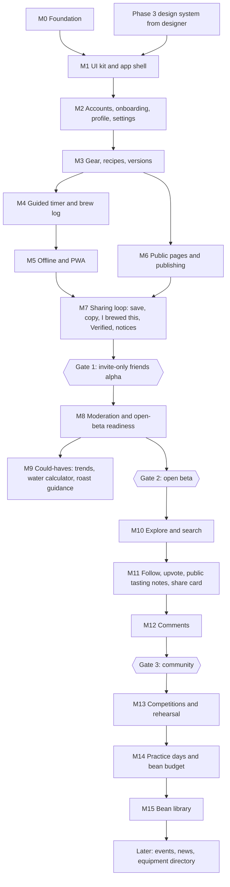

# Phase 5: Roadmap

Status: **draft for sign-off** · 13 Nov 2026

Milestones are sized for **one Claude Code session, or a short run of sessions**, each ending with something Aaron can test on his iPhone. Every milestone follows the routine in `claude-code-workflow.md`: plan first (`/model opusplan`), build in stages with commits, `test-runner`, `reviewer`, Aaron's phone check, `docs/progress.md` handoff.

**Test device priority:** iPhone (Safari, and installed to the Home Screen) first; Android Chrome second; desktop third.

---

## 1. Overview



| Milestone | Product phase | Gate it serves | Model | Rough size |
|---|---|---|---|---|
| M0 Foundation | 1 | — | `opusplan`; **Opus** for schema + RLS tests | 2–3 sessions |
| M1 UI kit and app shell | 1 | — | `opusplan` | 2 sessions |
| M2 Accounts, onboarding, profile, settings | 1 | — | `opusplan` | 2–3 sessions |
| M3 Gear, recipes, versions | 1 | — | `opusplan` | 3 sessions |
| M4 Guided timer and brew log | 1 | — | `opusplan` | 2–3 sessions |
| M5 Offline and PWA | 1 | — | **Opus** | 2 sessions |
| M6 Public pages and publishing | 1 | — | `opusplan` | 2 sessions |
| M7 Sharing loop | 1 | **Gate 1** | `opusplan` | 2–3 sessions |
| M8 Moderation and open-beta readiness | 1 | **Gate 2** | `opusplan` | 2–3 sessions |
| M9 Could-haves | 1 | optional | Sonnet | 1–2 sessions |
| M10–M12 | 2 | Gate 3 | planned in a later round | — |
| M13–M14 | 3 | — | planned in a later round | — |
| M15 + later | Later | — | planned in a later round | — |

**Dependency on the designer:** M0 doesn't need the design system. **M1 does.** If the designs aren't ready when M0 is done, M1 starts with the placeholder tokens from `designer-brief-token-samples.md`; a short "design pass" session swaps in the real tokens and restyles the components later. Tokens are CSS custom properties and components use only semantic names, so the swap touches one tokens file plus component polish, not the features.

**Product name:** kept in `src/config/site.ts` (name, short name, description) and one logo/icon set in `public/brand/`. Renaming later is a one-file change plus new icons.

**Timer:** the prototype timer is proven on iPhone; M4 ports its logic. No separate spike.

---

## 2. Product Phase 1 milestones

### M0 Foundation
**Goal:** an empty but production-shaped app: deployed, tested, secured, backed up.

**Scope**
- Next.js (App Router) + TypeScript strict, ESLint, Prettier, path aliases.
- Folder structure, `CLAUDE.md`, `docs/` (planning docs copied in), `.claude/agents/test-runner.md` and `reviewer.md`.
- Tokens file `src/styles/tokens.css` (placeholder values from the samples doc), base/reset CSS, light/dark via `[data-theme]` + `prefers-color-scheme`.
- Supabase: local dev with the Supabase CLI; **full Phase 1 schema migration** from `phase-4-system-design.md` §4 plus storage policies (§7) plus the **invite-only additions** (§4 below); seed data (gear catalogue ~80 common items, one admin user locally).
- **RLS test suite** (SQL tests run with `supabase test db`): private data unreadable by other users and visitors; brews never readable by anyone but the owner; moderator-only fields unchangeable by members; locked versions reject edits; publish rules.
- `@supabase/ssr` clients (browser, server, middleware) and session refresh middleware.
- TanStack Query provider + query-key factory; Sonner toaster; route error boundaries; Sentry.
- Vitest, Playwright (iPhone viewport project), axe checks wired in.
- GitHub Actions: CI on pull requests (typecheck, lint, unit tests, build); **nightly backup + keep-alive** workflow.
- Vercel project (Hobby, `sin1`), env vars, preview deployments; Supabase production project (Singapore); site URL from `NEXT_PUBLIC_SITE_URL`.
- PWA manifest and icons (placeholder), basic service worker registration (full offline in M5).
- A health page `/status` that shows build version and database connectivity (dev/admin only).

**Acceptance criteria**
- [ ] `npm run typecheck`, `lint`, `test`, `build` all pass locally and in CI.
- [ ] `supabase db reset` applies all migrations and seeds without errors; `supabase test db` passes every RLS test.
- [ ] Production URL loads on Aaron's iPhone; light and dark follow the phone setting.
- [ ] No service-role key or secret appears in the client bundle (checked by a CI step that greps the build output).
- [ ] Nightly workflow runs successfully once (manually triggered) and produces an encrypted backup artifact.
- [ ] Sentry receives a test error from production.

**Out of scope:** any real screens beyond a placeholder home and `/status`.
**Depends on:** Phase 4 (done).

---

### M1 UI kit and app shell
**Goal:** every core component from the design system, built once, accessible, in light and dark.

**Scope**
- Components from `designer-brief.md` §5 (buttons, inputs incl. number-with-unit, m:ss time input, 0–10 slider, select, combobox, switch, checkbox, radio, segmented control, chips, badges, cards, list rows, sheet, dialog, confirm, toast styling, empty state, skeleton, offline banner, error panel, form error summary, avatar).
- App shell: bottom tab bar (Home · Recipes · Brew · Verified · Profile) with centre Brew button; top bar with back, title, actions, notices bell; desktop top bar/left rail; logged-out top bar.
- A hidden `/dev/components` page showing every component in every state (dev only), used for review and axe tests.
- Loading/success/error patterns from `phase-4-amendments.md` §3 as reusable pieces.

**Acceptance criteria**
- [ ] Every component renders in all its states on `/dev/components`, in light and dark.
- [ ] axe reports **no** violations on `/dev/components` in either theme.
- [ ] Keyboard only: every control reachable, visible focus, logical order; dialogs and sheets trap focus and return it on close.
- [ ] All primary controls ≥ 44 × 44 px; text passes contrast checks with the design tokens.
- [ ] Reduced motion setting removes non-essential animation.
- [ ] No hard-coded colours, sizes or font values outside `tokens.css` (lint rule or CI grep).

**Out of scope:** data, routes beyond the shell.
**Depends on:** M0; Phase 3 (or placeholder tokens + later design pass).

---

### M2 Accounts, onboarding, profile, settings
**Goal:** a friend can be invited, sign up, set up their profile and settings, and delete their account.

**Scope**
- Invite-only sign-up (allowlist check before sign-up + enforced in the database), email + password, **email confirmation before first sign-in**, log in, log out, forgot/reset password, return-to-where-you-were after confirmation.
- Custom SMTP (Resend) on Aaron's domain; branded auth email templates.
- Onboarding (F2): units and region (pre-filled from device locale), gear step (links to M3 gear screen; skippable until then), photo and experience level, start screen; "Finish your profile" card on Home.
- Profile edit: display name, handle change (rules + 90-day redirect), photo upload (resize to 512 px WebP on device), bio, experience level, favourite gear (from gear list, once M3 exists; free text until then).
- Settings: units and region, account (change password, **download my data**, **delete account**), log out.
- Units display layer: helpers to format/parse °C/°F, g/oz, dates and times from stored metric values (unit-tested).
- Admin bootstrap: Aaron set as admin via a one-off SQL script in `supabase/scripts/`; admin screen to add allowlist emails.

**Acceptance criteria**
- [ ] An email **not** on the allowlist sees "Sign-ups are invite-only right now" and no account is created.
- [ ] An invited email can sign up, receives the confirmation email from Aaron's domain, taps it on the iPhone and lands signed in.
- [ ] Wrong password shows the agreed message; reset-password email works end to end.
- [ ] Onboarding steps can each be skipped; skipped steps appear in the Home checklist.
- [ ] Switching to °F and oz changes every displayed value; stored values don't change (unit test + manual check).
- [ ] Download my data returns a JSON file with the user's profile and settings (more data appears as later milestones add it).
- [ ] Delete account removes the user; logging in again fails; a test confirms related rows are gone.

**Out of scope:** Google sign-in (M8), public profile page (M6).
**Depends on:** M1.

---

### M3 Gear, recipes, versions
**Goal:** the core of the product: create a recipe with full context and structured steps, version it and compare versions.

**Scope**
- My gear (F3): categories, catalogue search + custom items, nickname, notes, defaults per category.
- Recipe editor (F4): basics, method (list + free text), gear pre-filled from defaults, coffee details, numbers, **steps editor** (pour, wait, swirl, stir, press, other; reorder; per-pour temperature when enabled), targets, notes; live calculated values (ratio, overall ratio, expected final volume, "+X g this pour", last pour vs brew water warning).
- Port and unit-test `calc` and `steps` logic from the prototype against the new model.
- Recipe page (owner view): header, version switcher, key numbers, steps, coffee, gear, targets, notes, (pour curve chart, Should have, lazy-loaded Recharts).
- Versioning (F5): new version, edit-in-place only while unlocked, locked-version notice, change note, version history, **compare any two versions** with changed fields highlighted.
- My recipes list: search mine, filter by method and visibility, sort by last brewed, archived tab; duplicate, archive, restore, delete (soft).
- Download my data now includes gear, recipes and versions.

**Acceptance criteria**
- [ ] A recipe with 6 steps (pour, swirl, wait, pour, press, other) can be created on the iPhone in under 3 minutes.
- [ ] Recipes for at least 5 methods (V60, Switch, AeroPress, French press, cold brew) can be expressed without workarounds.
- [ ] Gear defaults pre-fill a new recipe; changing a gear item later doesn't change existing recipes.
- [ ] Saving with name, method, dose or brew water missing shows the error summary and focuses the first error.
- [ ] Editing a version that has brews (seeded in tests) offers "save as new version" and the database rejects a direct edit.
- [ ] Version compare highlights exactly the fields that changed (unit test on the diff function + manual check).
- [ ] `calc` and `steps` unit tests cover ratio, bypass, expected volume, cumulative pours and edge cases (no steps, zero bypass).
- [ ] Editing while offline shows "Creating and editing recipes needs a connection" and keeps the form contents.

**Out of scope:** public visibility (M6), copying others' recipes (M7).
**Depends on:** M2.

---

### M4 Guided timer and brew log
**Goal:** brew any recipe version with the guided timer and log the findings.

**Scope**
- Brew picker (centre button): recent recipes first, search mine; choose guided timer or log only.
- **Guided timer** (port of the prototype logic): prep screen, Start (unlocks audio), 3–5 s count-in, current and next step with time, target weight, temperature and technique, wake lock, optional sound and vibration, pause, end early (log or discard), "Drawdown done" recording drawdown time, correct clock after leaving the app and coming back, missed-cue summary. Recipes without steps get a simple stopwatch.
- **Brew log** (F6): pre-filled recipe/version/date/drawdown; results (drawdown, beverage weight, TDS); EY and ratio against targets; 8 taste sliders with live radar (Recharts); flavour tags (presets + custom); tasted at; notes; "Next time I'll change…"; save with only overall filled; draft auto-saved on the device.
- Brew detail; brew history per recipe and per version; edit/delete brew; **Create next version** from a brew (editor opens with the note pinned).
- Compare 2–3 brews (Should): radar overlay with distinct line styles + side-by-side table.
- Events: `timer_started`, `timer_completed`, `timer_abandoned`.
- Home: "Continue" card (last recipe + Brew again) and recent brews.

**Acceptance criteria**
- [ ] On the iPhone (Safari and Home Screen app): timer runs a 6-step recipe, cues each step, keeps the screen on, and the clock is correct after locking the phone for 30 s.
- [ ] Finishing a timer opens the log with drawdown pre-filled; saving with only the overall score works.
- [ ] EY shown matches TDS × beverage ÷ dose (unit test) and is flagged against the version's targets.
- [ ] Radar updates live as sliders move; sliders work by touch, keyboard and screen reader (value announced).
- [ ] Logging a brew locks that version (database check).
- [ ] Closing the log form mid-way and reopening restores the draft.
- [ ] Every chart has a text alternative.

**Out of scope:** offline saving (M5), brewing others' recipes (M7).
**Depends on:** M3.

---

### M5 Offline and PWA
**Goal:** the brew bar works without signal, and nothing is ever lost.

**Scope**
- Serwist service worker: precached app shell and core routes; offline fallback page.
- TanStack Query cache persisted to IndexedDB (own recipes, versions, gear, settings, recent brews).
- **Brew outbox** in IndexedDB (Dexie): device-generated IDs, `base_updated_at`, sync on reconnect/focus/30 s, backoff, conflict handling ("updated elsewhere"), **Needs attention** list for rejected writes (retry/discard), incremental pull with tombstones, 30-day tombstone purge job (database schedule).
- Sync status indicator; offline banner; "waiting to sync" badges.
- Install guidance for iPhone (Share → Add to Home Screen) shown once on iOS Safari; `pwa_installed` event.
- Sign-out clears local data.

**Acceptance criteria**
- [ ] With the iPhone in Airplane Mode: open the installed app, open a recipe, run the timer, save a brew; it shows "waiting to sync".
- [ ] Turning Airplane Mode off syncs the brew within 30 s without duplicates (repeat 10 times in a test).
- [ ] Editing the same brew on two devices offline then online results in one version and an "updated elsewhere" notice, never silent loss.
- [ ] A brew the server rejects lands in "Needs attention" and doesn't block later brews.
- [ ] Unit tests cover the outbox state machine (queued → sent → done / conflict / needs attention / retry).
- [ ] Lighthouse PWA installability passes; app opens offline after first visit.

**Out of scope:** offline recipe editing (by design).
**Depends on:** M4.

---

### M6 Public pages and publishing
**Goal:** recipes can go public, and public pages look right when shared.

**Scope**
- Visibility control (F7): private ↔ public with email-verified check and new-account publish limit messages; make-private confirm dialog.
- **Public recipe page** (server-rendered): same URL for everyone, owner controls only for owner, all versions, version compare, counts ("v6 · 18 brews · brewed by 4 others"), credit line for copies.
- **Link previews**: `generateMetadata` + Open Graph image route (recipe name, method, key numbers, author).
- **Public profile page** (`/@handle`): photo, name, handle, verified badge, experience, bio, favourite gear, stats (RPC), public recipes; own profile adds Saved (M7), Edit, Settings.
- "Not available" page for private/hidden/missing recipes and profiles; handle redirects (90 days).
- Print page `/@handle/slug/print` (Should).
- Find a user by handle (Should).
- Logged-out top bar and sign-up banners on public pages.
- `share_link_opened` event (server-side, no cookies).

**Acceptance criteria**
- [ ] Pasting a public recipe link into WhatsApp/iMessage shows a preview with the recipe name and key numbers.
- [ ] A private recipe URL opened logged out, or by another user, shows exactly the same page as a non-existent URL.
- [ ] Unverified email → "Verify your email before making recipes public"; 6th publish on a new account within 24 h → publish-limit message.
- [ ] Public pages score ≥ 90 on Lighthouse performance and SEO on mobile.
- [ ] Old handle URL redirects to the new handle.
- [ ] Print page fits a recipe on one A4 page in Safari's print preview.

**Out of scope:** save/copy/I brewed this (M7), Explore (Phase 2).
**Depends on:** M3 (can run in parallel with M4–M5).

---

### M7 Sharing loop: save, copy, I brewed this, Verified, notices → Gate 1
**Goal:** friends can use each other's recipes, and the app is ready for the invite-only alpha.

**Scope**
- **Save** (bookmark) and Saved section in own Profile.
- **Copy with credit** (RPC): copy lands private as v1 with "Copied from @user v3"; credit rules when original is private/deleted.
- **"I brewed this"**: brew a public recipe from someone else (timer or log only); shows in my history with credit; author's counters update.
- **Visitor flow (F8)**: brew a public recipe without an account; sign-up sheet on save/copy/I brewed this/saving the log; the action completes after sign-up and email confirmation; pending brew log kept on the device until then.
- **Verified tab**: feed of public recipes by verified profiles (RPC), filter by method, paging, empty state.
- **Notices**: bell with unread count; list (verified, recipe hidden/restored, copied, brewed); mark read.
- Admin: grant/remove verified (minimal screen; full moderation tools in M8).
- Gate 1 metrics SQL views (admin only) and a simple admin metrics page.
- Download my data now complete (brews, saved, notices).

**Acceptance criteria**
- [ ] Friend A copies Friend B's public recipe; it appears private in A's recipes with the credit line; B gets a notice.
- [ ] A logs "I brewed this" on B's recipe; B's recipe shows "brewed by 1 other"; A's brew is invisible to B (RLS test).
- [ ] A logged-out visitor brews a public recipe, fills the log, signs up (invited email), confirms, and the brew appears in their history.
- [ ] Marking a user verified makes their public recipes appear in Verified within one refresh.
- [ ] Admin metrics page shows the Gate 1 numbers for the last 4 weeks.
- [ ] **Alpha checklist**: 8–12 friends invited; Aaron and partner are admin/moderator; backups ran for 7 nights in a row; Sentry shows no unresolved errors.

**Out of scope:** reports and moderation queue (M8).
**Depends on:** M5, M6.

> **Gate 1: friends alpha** (invite-only). Pass when ≥ 6 friends log ≥ 2 brews/week for 4 straight weeks and half have dropped their old notes.

---

### M8 Moderation and open-beta readiness → Gate 2
**Goal:** safe to open sign-ups to the public.

**Scope**
- **Report** recipe or profile (logged-in), reasons, duplicate prevention.
- Moderator screens: reports (dismiss / hide content with reason / suspend), users (search, verify, suspend, role change for admins), hidden content (restore); moderation log.
- Suspended-account experience; hidden-content notice with reason.
- **Turn off invite-only** (config flag); publish limit for new accounts active.
- Sign in with Google (Should) incl. handle selection.
- Terms and privacy pages (content from the legal check, OQ11); cookie-free analytics note.
- Fixes and polish from alpha feedback (time-boxed list agreed after Gate 1).
- Load check: seed 1,000 users / 50,000 brews in a staging project; key pages stay fast.

**Acceptance criteria**
- [ ] A report on a recipe appears in the moderator queue; hiding it removes it from all public views and notifies the author with the reason.
- [ ] A suspended user can sign in but every write fails with the suspension message; their public content disappears.
- [ ] Only admins can change roles (RLS/RPC tests).
- [ ] With invite-only off, a new account can publish 5 recipes in 24 h and is blocked on the 6th.
- [ ] Google sign-up asks for a handle before anything is public.
- [ ] Terms and privacy pages are linked from sign-up and settings.
- [ ] Recipe page and Home load in < 2 s on a mid-range phone over 4G with the seeded dataset.

**Depends on:** Gate 1 passed.

> **Gate 2: open beta** (~100 users, Malaysian/SEA community).

### M9 Could-haves (optional, any time after M7)
Recipe trend charts (grind vs drawdown, overall score over time, TDS vs EY), water calculator with configurable concentrate, roast-level guidance hints. Each is independent; build only if alpha feedback asks for it.

---

## 3. Later product phases (outline; detailed planning round after Gate 2)

| Milestone | Scope (from Phase 2 outlines) | Depends on |
|---|---|---|
| **M10 Explore and search** | Verified tab becomes Explore; search by coffee, origin, process, method, brewer, roast level; popular and most-brewed sections | Gate 2 |
| **M11 Follow, upvote, tasting notes, share card** | Follow, upvote only, opt-in public tasting notes on "I brewed this", follower counts, Instagram share card image, new notice types | M10 |
| **M12 Comments** | Comments with replies, reporting and hiding | M11 |
| **M13 Competitions and rehearsal** | Competition setup (time limits, min serving, approved equipment, rules PDF), linked training recipes, rehearsal mode on the guided timer with prep/brew clocks and rule checks, rehearsal runs | Gate 3 or Aaron's call |
| **M14 Practice days and bean budget** | Runs grouped by day with conclusions and next-session plans; bean budget with discards; Home countdown card | M13 |
| **M15 Bean library** | "My coffees": bags with roast date, grams remaining, days since roast; pick a bag when brewing | M7 |
| **Later** | Events, news, equipment directory | Product decision |

Each later milestone gets its own planning round (flows, schema migration from Phase 4 §5, prompts).

---

## 4. Schema addition for the invite-only alpha (included in M0)

```sql
create table public.app_config (
  key   text primary key,
  value jsonb not null
);
insert into public.app_config (key, value) values ('invite_only', 'true'::jsonb);

create table public.signup_allowlist (
  email      citext primary key,
  invited_by uuid references public.profiles(id) on delete set null,
  created_at timestamptz not null default now()
);

alter table public.app_config       enable row level security;
alter table public.signup_allowlist enable row level security;

create policy app_config_read  on public.app_config for select using (true);
create policy app_config_admin on public.app_config for all using (public.is_admin()) with check (public.is_admin());
create policy allowlist_admin  on public.signup_allowlist for all using (public.is_admin()) with check (public.is_admin());

-- Friendly check before calling supabase.auth.signUp
create or replace function public.can_sign_up(p_email text)
returns boolean language sql stable security definer set search_path = public as $$
  select coalesce((select value::text <> 'true' from public.app_config where key = 'invite_only'), true)
      or exists (select 1 from public.signup_allowlist where email = lower(p_email)::citext);
$$;
grant execute on function public.can_sign_up to anon, authenticated;

-- Enforcement: add to the top of public.handle_new_user()
--   if not public.can_sign_up(new.email) then
--     raise exception 'invite_only' using errcode = 'P0001';
--   end if;
```

The M0 build prompt will include the full, updated `handle_new_user()` function with this check in place.

---

## 5. Decisions in this phase
1. Invite-only friends alpha; moderation tools land in M8, before sign-ups open.
2. No fixed dates; core loop first (M3 → M4 → M5); Could-haves cut first, then Should-haves.
3. iPhone is the primary test device.
4. CAFEC interviews dropped; feedback comes from the alpha.
5. Product name decided late; kept in one config file and one asset folder.
6. M1 depends on the design system; placeholder tokens + design pass if the designer is late.
7. Later phases get their own planning round after Gate 2.
